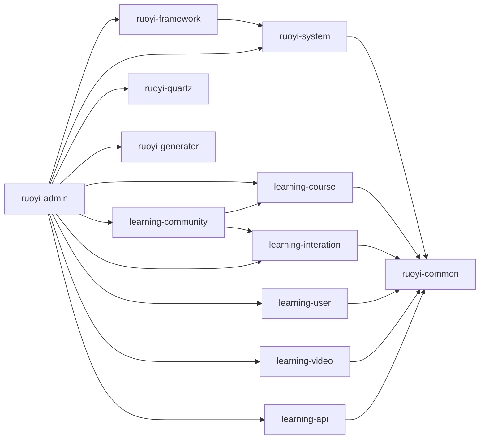
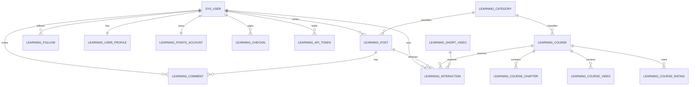
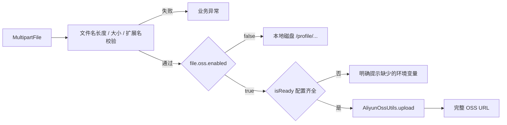
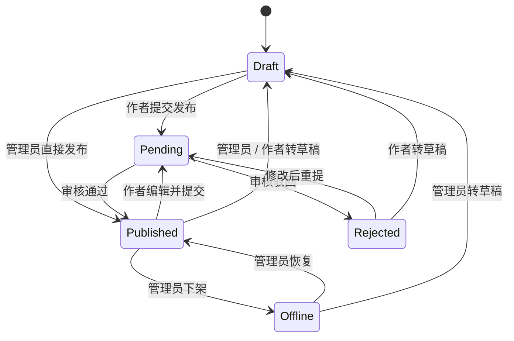
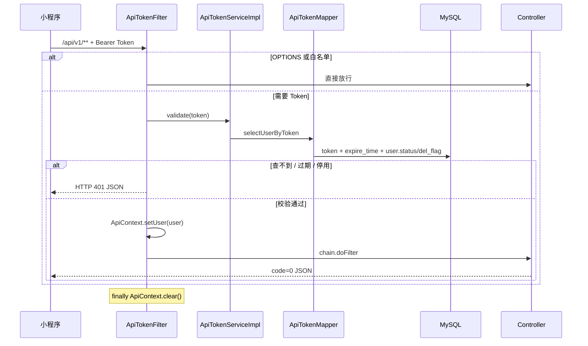

# 学习平台项目介绍

> **项目定位**：基于 RuoYi 4.8.3 二次开发的课程 / 社区文章 / 短视频学习平台  
> **文档用途**：项目熟悉手册 + Java 后端面试自我介绍与追问素材  
> **代码基线**：`category` 分支（含用户端发布文章接口改动）；文档日期 2026-10-28  
> **阅读约定**：`【基座】` 表示若依原有能力，`【自研】` 表示本项目新增或改造，`【部分实现】` / `【未实现】` 表示当前边界，`【面试讲法】` 表示可以直接借鉴的表达方式。

**目录**

- 第 0 章 文档说明与速览
- 第 1 章 项目定位与职责边界
- 第 2 章 技术栈全景
- 第 3 章 系统架构与模块职责
- 第 4 章 数据模型
- 第 5 章 功能地图
- 第 6 章 三个最难功能详解
- 第 7 章 关键工程机制
- 第 8 章 边界、风险与待补项
- 第 9 章 本地运行与数据准备
- 第 10 章 面试材料
- 第 11 章 附录

---

## 0. 文档说明与速览

### 0.1 怎么读这份文档

| 目标 | 建议路线 | 预计时间 |
|---|---|---|
| 先熟悉项目 | 第 1 章 → 第 3 章 → 第 4 章 → 第 5 章 | 40–60 分钟 |
| 面试速成 | 第 0 章 → 第 2 章 → 第 6 章 → 第 10 章 | 30–40 分钟 |
| 排障 / 二次开发 | 第 3 章 → 第 7 章 → 第 8 章 → 第 9 章 → 附录 | 按需查阅 |

### 0.2 一分钟项目速览

| 维度 | 说明 |
|---|---|
| 项目是什么 | 一个面向学习者的内容平台：课程、社区文章、短视频，配套点赞收藏、两级评论、关注、通知、笔记、观看历史、签到积分与免广告兑换 |
| 服务谁 | 两类使用者：后台管理员（内容维护、帖子审核、系统管理）与小程序 / H5 学习者（浏览、互动、学习、签到） |
| 技术形态 | 单体应用，内嵌 Tomcat，Thymeleaf 服务端渲染后台 + `/api/v1/**` JSON 接口；不是微服务、不是前后端分离工程 |
| 基座 | RuoYi 4.8.3（Shiro + MyBatis + PageHelper + Druid + Ehcache + Quartz + 代码生成） |
| 自研范围 | 6 个 `learning-*` 业务模块：课程、社区、互动、用户成长、短视频、Token 鉴权 |
| 数据 | MySQL 8.0.46，19 张 `learning_*` 业务表 + 若依 `sys_*` 表；逻辑外键；统一 `del_flag` 软删除 |
| 移动端鉴权 | 数据库随机 Token（`learning_api_token`），`Authorization: Bearer <token>` 或 `X-Token`，有效期 30 天，可吊销 |
| 最值得讲的三件事 | ① 数据库 Token 与 Shiro 会话并存；② 社区帖子「先审后发」状态机；③ OSS 接入与历史 URL 兼容 |

> 【面试讲法】一句话版本：**「这是一个基于 RuoYi 4.8.3 二次开发的学习平台，后台复用若依的 RBAC 和系统管理，我主要实现了课程、社区、互动、成长体系和移动端 Token 接口这 6 个业务模块。」**

### 0.3 事实台账

| 事实 | 数据 | 口径 |
|---|---|---|
| Maven 模块 | 12 个 | 6 个若依基座模块 + 6 个 `learning-*` 业务模块 |
| Java 代码 | 约 5.4 万行 / 411 个文件 | `src/main/java` 静态统计，不含 `target/` |
| `learning-*` 业务代码 | 约 1.46 万行 / 118 个文件 | 课程与互动模块占比最大 |
| MyBatis Mapper XML | 43 个 | 其中 `learning-*` 约 22 个 |
| Thymeleaf 模板 | 174 个（后台 164 个）/ 后台约 3.06 万行 | 业务页面集中在 `course`、`community`、`video`；另有 Quartz / 代码生成模板 |
| SQL 脚本 | 32 个 | `sql/*.sql`，建表 / 加列 / 菜单权限 / 对账 / 回滚；仓库**不含**完整若依初始化库 |
| 自动化测试 | 0 | 未发现 `src/test` 测试代码，本文只做静态核对 |
| 压测 / 性能数据 | 无 | 文档中不写 QPS、并发量、响应时间 |
| 缓存 | Ehcache 3.12.0 | JVM 本地缓存，不是 Redis，不跨实例 |
| 消息队列 / 搜索引擎 | 无 | 搜索是 MySQL 标题模糊查询 |
| 部署 | 单体 JAR / WAR | 无 Docker、无 CI/CD、无 K8s |

### 0.4 安全声明

本文不包含任何真实数据库地址、库名、账号、密码、Druid 控制台账号、OSS Bucket / Endpoint / AccessKey、测试账号或真实 Token。示例统一使用 `<DB_HOST>`、`<OSS_BUCKET>`、`<TOKEN>` 等占位符；仓库配置中的明文凭据属于待改进项，已在第 8 章说明。

---

## 1. 项目定位与职责边界

### 1.1 一句话定位

这是一个**以内容消费和轻量社区为核心的学习平台**：

- **学习侧**：课程（章节 + 课时视频）、短视频、文章；支持点赞、收藏、评论、关注、笔记、观看历史与断点续播。
- **成长侧**：每日签到、连续签到积分、积分账户、积分流水、用积分兑换免广告时长。
- **创作侧**：普通用户在 App 端发布文章（`POST /api/v1/post/add`），进入「待审核」；管理员在后台审核通过后公开，可设精华、写驳回原因。
- **管理侧**：课程 / 章节 / 课时 / 类别 / 轮播 / 短视频 / 帖子 / 评论 / 用户 / 角色 / 菜单 / 字典 / 日志 / 监控。
- **多端**：后台是 Thymeleaf 服务端渲染；小程序 / H5 使用 `/api/v1/**` Token 接口；旧版小程序仍可使用 `/api/**` 会话接口。

### 1.2 为什么在 RuoYi 上二次开发

选择 RuoYi 4.8.3 作为基座，主要复用四类能力：

1. **权限体系**：用户、角色、菜单、按钮权限、数据权限、Shiro 会话、验证码、在线用户、踢人下线。
2. **后台骨架**：Thymeleaf 模板、Bootstrap Table 列表、导入导出、表单校验、操作日志、登录日志。
3. **基础设施**：MyBatis + PageHelper + Druid + Ehcache + Quartz + 代码生成器 + Swagger。
4. **工程规范**：`AjaxResult`、`TableDataInfo`、`BaseEntity`、全局异常处理、XSS 过滤、重复提交拦截。

业务没有直接塞进 `ruoyi-system`，而是拆成 6 个 `learning-*` 模块，目的是：

- 业务代码与框架代码解耦，后续可以单独替换或拆分；
- 模块依赖清晰：大部分业务模块只依赖 `ruoyi-common`；
- 便于在面试中讲清楚「哪些是基座能力、哪些是我做的」。

### 1.3 基座 vs 自研边界（重要）

| 范围 | 若依基座【基座】 | 本项目自研 / 改造【自研】 |
|---|---|---|
| 登录与权限 | 后台账号登录、验证码、Shiro 会话、RBAC、菜单、数据权限 | 手机号注册、`/api/v1` 数据库 Token、改密吊销全部 Token、`ApiContext` |
| 内容 | 无 | 课程、章节、课时、课程类别、轮播、帖子、短视频 |
| 互动 | 无 | 点赞、收藏、两级评论、关注、用户通知、笔记、观看历史 |
| 成长体系 | 无 | 签到、积分账户、积分流水、免广告兑换 |
| 文件 | 本地上传、下载、Excel 导出 | 阿里云 OSS 接入、历史 URL 兼容、App 图片上传 |
| 数据 | 若依 `sys_*` 表 | 19 张 `learning_*` 表、32 个幂等 SQL 脚本、对账脚本 |
| 后台页面 | 系统管理、监控、工具页 | `course`、`community`、`video` 业务页面 |
| 移动端接口 | 无 | `/api/**` 旧会话接口 + `/api/v1/**` Token 接口 |

> 【面试讲法】不要把所有东西都说成自己写的。可以这样表述：**「后台的 RBAC、菜单、监控、代码生成是若依基座；我主要做的是 6 个业务模块、19 张业务表、移动端 Token 鉴权、OSS 接入和审核链路。」** 这样既真实，又能把话题引到自己熟悉的领域。

### 1.4 双端与双 API 形态

| 端 | 入口 | 鉴权 | 身份来源 | 典型返回 |
|---|---|---|---|---|
| 后台管理 | `/system/**`、`/course/**`、`/community/**`、`/video/**` | Shiro Session + Cookie + 权限注解 | `ShiroUtils.getUserId()` | Thymeleaf 页面、`AjaxResult`、`TableDataInfo` |
| 新小程序 / H5 | `/api/v1/**` | `ApiTokenFilter` + 数据库 Token | `ApiContext.getUserId()` | JSON（成功 `code=0`） |
| 旧小程序 | `/api/**` | Shiro Session | `ShiroUtils` | JSON |

两套 API **不是完整镜像**：

- 旧 `/api/**` 覆盖课程列表、轮播、评分、关注、互动、评论、通知等存量功能；
- 新 `/api/v1/**` 覆盖上述功能，并新增笔记、观看历史、签到、积分、搜索、上传、个人资料 / 主页、改密等；
- 帖子可在 App 端发布（v1 `POST /api/v1/post/add`，提交后进入待审核），编辑 / 审核仍在后台；短视频 CRUD、课程详情 / 章节 / 课时维护也只在后台，**没有对应的客户端接口**；
- 面试时不要把后台能力说成小程序已经具备。

### 1.5 代码规模与阅读路线

- 先看 `pom.xml` 和 `ruoyi-admin/src/main/resources/application.yml`，建立技术栈与配置的整体印象；
- 再看 `learning-api` 的 `ApiTokenFilter`，理解移动端请求如何进入系统；
- 然后按「课程 → 社区 → 互动 → 用户成长」的顺序看模块；
- 每个模块的入口是 `controller`，业务规则在 `service/impl`，SQL 在 `resources/mapper`；
- 后台页面在 `ruoyi-admin/src/main/resources/templates`（所有模块的模板都集中在 admin 模块）。

---

## 2. 技术栈全景

### 2.1 版本口径说明

- 后端版本以根 `pom.xml`、各模块 `pom.xml` 和构建产物依赖树为准；
- PageHelper 有两层版本：**核心 `pagehelper` 6.1.1**，**启动器 `pagehelper-spring-boot-starter` 4.1.1**；
- Spring Boot 4.1.0 会同时带入 Jackson 2.x 与 Jackson 3.x，属于 Boot 4 的过渡形态；
- 前端没有 `package.json`，版本来自静态资源文件头、目录名和模板引用；
- 项目使用 **Java 17**，`.idea/misc.xml` 里曾出现 JDK 23，以 `pom.xml` 为准。

### 2.2 后端核心依赖

| 分类 | 依赖 | 版本 | 用途 |
|---|---|---|---|
| 语言 / 运行时 | Java | 17 | 编译与运行基线 |
| 基础框架 | Spring Boot | 4.1.0 | 自动配置、Web、事务、校验 |
| 基础框架 | Spring Framework | 7.0.8 | IoC、MVC、AOP、JDBC、事务 |
| Web 容器 | Tomcat（内嵌） | 11.0.22 | Servlet 容器，Jakarta 命名空间 |
| Web 规范 | Jakarta Servlet | 6.1 | `jakarta.servlet.*` |
| 安全框架 | Apache Shiro | 3.0.0 | 后台登录、RBAC、会话、JCache |
| 安全模块 | shiro-core / shiro-web / shiro-spring / shiro-jcache | 3.0.0 | Shiro 核心、Web、Spring 集成、JCache 桥接 |
| 模板权限 | thymeleaf-extras-shiro | 2.1.0 | 页面上的 `shiro:` 标签 |
| 持久层 | MyBatis | 3.5.19 | SQL 映射、Mapper XML |
| 持久层集成 | mybatis-spring-boot-starter | 4.1.0 | MyBatis 与 Spring Boot 集成 |
| 分页 | PageHelper（核心） | 6.1.1 | 物理分页、自动 count |
| 分页启动器 | pagehelper-spring-boot-starter | 4.1.1 | 分页自动配置 |
| SQL 解析 | JSqlParser | 4.7 | PageHelper 解析 SQL |
| 连接池 | Druid | 1.2.28 | 连接池、慢 SQL、SQL 监控 |
| 连接池启动器 | druid-spring-boot-4-starter | 1.2.28 | Boot 4 专用 Druid Starter |
| 数据库 | MySQL Server | 8.0.46 | 业务库，utf8mb4 / InnoDB |
| JDBC 驱动 | mysql-connector-j | 9.7.0 | MySQL 驱动 |
| 本地缓存 | Ehcache（jakarta classifier） | 3.12.0 | Shiro 缓存、字典、参数缓存 |
| 缓存规范 | JCache API | 1.1.1 | Ehcache 的 JCache 接口 |
| 缓存实现依赖 | Caffeine | 3.2.4 | Ehcache 内部依赖 |
| 模板引擎 | Thymeleaf | 3.1.5 | 后台页面服务端渲染 |
| 接口文档 | springdoc-openapi | 3.1.0 | OpenAPI 3 |
| 接口文档 UI | Swagger UI | 5.32.11 | `/swagger-ui.html` |
| 对象存储 | 阿里云 OSS SDK | 3.17.4 | 文件上传 |
| 阿里云依赖 | aliyun-java-sdk-core / kms / ram | 4.5.10 / 2.11.0 / 3.1.0 | OSS SDK 传递依赖 |
| HTTP 客户端 | Apache HttpClient | 4.5.13 | 阿里云 SDK 传递依赖 |
| 定时任务 | Quartz | 2.5.2 | 若依任务管理（基座） |
| Excel | Apache POI（poi / poi-ooxml） | 5.5.1 | 后台导入导出 |
| XML 依赖 | XmlBeans | 5.3.0 | POI 传递依赖 |
| 代码生成 | Velocity | 2.3 | 代码生成模板引擎 |
| 验证码 | Kaptcha（pro.fessional） | 2.3.3 | 后台数学验证码 |
| 服务器监控 | OSHI | 7.4.4 | CPU / 内存 / 磁盘 |
| 用户代理解析 | yauaa | 8.2.0 | 登录日志的浏览器 / 系统识别 |
| JSON（遗留） | fastjson | 1.2.84 | 过滤器错误响应等少量路径 |
| JSON（MVC） | Jackson | 2.21.4 + 3.1.4 | Spring MVC 序列化（Boot 4 过渡） |
| 工具 | commons-lang3 | 3.20.0 | 字符串、对象工具 |
| 工具 | commons-io | 2.22.0 | 文件与流 |
| 工具 | commons-codec / compress / beanutils / collections4 | 随依赖树 | 编码、压缩、Bean、集合 |
| 校验 | Hibernate Validator | 9.1.0 | Bean Validation |
| 校验规范 | jakarta.validation-api | 3.1.1 | 校验注解 |
| 日志 | Logback | 1.5.34 | 应用日志 |
| 日志门面 | SLF4J | 2.0.18 | 日志 API |
| 日志桥接 | log4j-to-slf4j | 2.25.4 | 第三方日志统一 |
| AOP | aspectjweaver | 1.9.25.1 | 权限、日志、数据源切面 |
| 指标 | Micrometer | 1.17.0 | 基础指标 |
| 其他 | gson / snakeyaml / JNA / webjars-locator-lite | 2.13.2 / 2.6 / 5.19.1 / 1.1.3 | 传递依赖 |
| 连接池（未启用） | HikariCP | 7.0.2 | Boot 默认连接池，项目实际使用 Druid |

**构建插件**：

| 插件 | 版本 | 用途 |
|---|---|---|
| maven-compiler-plugin | 3.13.0 | Java 17 编译，开启 `-parameters` |
| spring-boot-maven-plugin | 4.1.0 | 可执行 JAR / repackage |
| maven-war-plugin | 3.1.0 | 可打 WAR，兼容传统部署 |
| yuicompressor-maven-plugin | 1.5.1 | 已在 POM 中注释掉，未启用 |

#### 2.2.1 关键 Maven 坐标速查

> 便于对照 `pom.xml`；标注「传递」的版本由依赖树决定，实际以 `mvn dependency:tree` 为准。

| Maven 坐标 | 版本 | 说明 |
|---|---|---|
| `org.springframework.boot:spring-boot-dependencies` | 4.1.0 | Spring Boot BOM，统一管理版本 |
| `org.springframework.boot:spring-boot-starter-webmvc` | 4.1.0 | Spring MVC / 内嵌 Tomcat |
| `org.springframework.boot:spring-boot-starter-thymeleaf` | 4.1.0 | Thymeleaf 模板 |
| `org.springframework.boot:spring-boot-starter-validation` | 4.1.0 | Bean Validation |
| `org.springframework.boot:spring-boot-starter-quartz` | 4.1.0 | Quartz 定时任务 |
| `org.springframework.boot:spring-boot-starter-aspectj` | 4.1.0 | AOP |
| `org.apache.shiro:shiro-core` | 3.0.0 | Shiro 核心 |
| `org.apache.shiro:shiro-web` | 3.0.0 | Shiro Web |
| `org.apache.shiro:shiro-spring` | 3.0.0 | Shiro Spring 集成 |
| `org.apache.shiro:shiro-jcache` | 3.0.0 | Shiro JCache |
| `com.github.theborakompanioni:thymeleaf-extras-shiro` | 2.1.0 | 模板 Shiro 标签 |
| `org.mybatis.spring.boot:mybatis-spring-boot-starter` | 4.1.0 | MyBatis 集成 |
| `org.mybatis:mybatis` | 3.5.19 | MyBatis 核心（传递） |
| `com.github.pagehelper:pagehelper-spring-boot-starter` | 4.1.1 | PageHelper 启动器 |
| `com.github.pagehelper:pagehelper` | 6.1.1 | PageHelper 核心（传递） |
| `com.github.jsqlparser:jsqlparser` | 4.7 | SQL 解析（传递） |
| `com.alibaba:druid-spring-boot-4-starter` | 1.2.28 | Druid 连接池 |
| `com.mysql:mysql-connector-j` | 9.7.0 | MySQL 驱动 |
| `org.ehcache:ehcache` | 3.12.0（jakarta） | Ehcache |
| `javax.cache:cache-api` | 1.1.1 | JCache API |
| `com.github.ben-manes.caffeine:caffeine` | 3.2.4 | Ehcache 依赖（传递） |
| `org.thymeleaf:thymeleaf` | 3.1.5.RELEASE | 模板引擎（传递） |
| `org.springdoc:springdoc-openapi-starter-webmvc-ui` | 3.1.0 | OpenAPI / Swagger UI |
| `com.aliyun.oss:aliyun-sdk-oss` | 3.17.4 | 阿里云 OSS |
| `com.aliyun:aliyun-java-sdk-core` | 4.5.10 | 阿里云 SDK 核心（传递） |
| `com.aliyun:aliyun-java-sdk-kms` | 2.11.0 | 阿里云 KMS（传递） |
| `com.aliyun:aliyun-java-sdk-ram` | 3.1.0 | 阿里云 RAM（传递） |
| `org.apache.httpcomponents:httpclient` | 4.5.13 | HTTP 客户端（传递） |
| `org.quartz-scheduler:quartz` | 2.5.2 | Quartz 核心（传递） |
| `org.apache.poi:poi-ooxml` | 5.5.1 | Excel 导入导出 |
| `org.apache.velocity:velocity-engine-core` | 2.3 | 代码生成模板 |
| `pro.fessional:kaptcha` | 2.3.3 | 图形验证码 |
| `com.github.oshi:oshi-core` | 7.4.4 | 服务器监控 |
| `nl.basjes.parse.useragent:yauaa` | 8.2.0 | 用户代理解析 |
| `com.alibaba:fastjson` | 1.2.84 | JSON（遗留路径） |
| `org.apache.commons:commons-lang3` | 3.20.0 | 通用工具 |
| `commons-io:commons-io` | 2.22.0 | IO 工具 |
| `org.hibernate.validator:hibernate-validator` | 9.1.0.Final | 校验实现（传递） |
| `jakarta.validation:jakarta.validation-api` | 3.1.1 | 校验规范（传递） |
| `ch.qos.logback:logback-classic` | 1.5.34 | 日志实现（传递） |
| `org.slf4j:slf4j-api` | 2.0.18 | 日志门面（传递） |
| `org.aspectj:aspectjweaver` | 1.9.25.1 | AOP（传递） |
| `com.zaxxer:HikariCP` | 7.0.2 | 连接池（传递，未启用） |
| `org.apache.xmlbeans:xmlbeans` | 5.3.0 | POI 依赖（传递） |
| `io.micrometer:micrometer-core` | 1.17.0 | 指标（传递） |
| `org.yaml:snakeyaml` | 2.6 | YAML 解析（传递） |
| `com.google.code.gson:gson` | 2.13.2 | JSON（传递） |
| `net.java.dev.jna:jna` | 5.19.1 | 本地系统调用（传递） |

### 2.3 前端与静态资源

项目**没有 Node/npm 工程**，前端资源直接提交在 `ruoyi-admin/src/main/resources/static`，由 Thymeleaf 模板引用。

| 组件 | 版本 | 用途 |
|---|---|---|
| Bootstrap | 3.4.1 | 后台栅格、按钮、表单、模态框 |
| jQuery | 3.7.1 | DOM 操作、AJAX |
| jQuery UI | 1.10.4 | 部分旧组件 |
| Font Awesome | 4.7.0 | 图标 |
| layui | 2.8.18 | 弹层、日期、部分表单组件 |
| layer | 3.7.0 | 弹层 |
| Bootstrap Table | 1.24.1 | 后台列表、分页、排序、导出 |
| iCheck | 未标注 | 复选框 / 单选框美化 |
| Select2 | 4.0.13 | 下拉搜索 |
| bootstrap-select | 1.13.18 | 下拉增强 |
| bootstrap-fileinput | 5.5.4 | 文件上传控件 |
| jQuery Validate | 1.21.0 | 表单校验（含 additional-methods） |
| Cropper | 1.5.12 | 头像裁剪 |
| Summernote | 0.8.18 | 后台富文本编辑 |
| EasyMDE | 2.21.0 | 帖子 Markdown 编辑 |
| marked | 4.3.0 | Markdown 渲染 |
| DOMPurify | 3.2.7 | Markdown 渲染后的 HTML 消毒 |
| highlight.js | 10.3.2 | 代码高亮 |
| zTree | 3.5 | 菜单 / 部门树 |
| Flot | 0.7 | 图表 |
| jQuery blockUI | 2.70.0 | 加载遮罩 |
| jquery.cxSelect | 1.4.2 | 省市区级联 |
| bootstrap-duallistbox | 3.0.9 | 双列表选择 |
| bootstrap-typeahead | 4.0.2 | 输入联想 |
| bootstrap-suggest | 0.1.29 | 输入建议 |
| three.js | r53 | 登录页背景动画 |
| metisMenu / slimScroll | 未标注 | 侧边栏与滚动条 |
| animate.css / login.css / style.css / skins.css | 未标注 | 页面样式 |

> 【面试讲法】如果被问「前端谁做的」，如实说：**「后台页面是若依的 Thymeleaf + Bootstrap 体系，我主要做后端接口、业务页面模板和前后端联调；项目没有独立的前端工程。」**

### 2.4 明确未采用的技术（避免误判）

| 技术 | 实际情况 |
|---|---|
| JWT | **没有**。移动端 Token 是数据库随机字符串，不是 JWT，没有签名、没有 payload |
| Redis | **没有**。缓存是 Ehcache（JVM 本地）；Token 落 MySQL |
| MyBatis-Plus | **没有**。使用原生 MyBatis + XML |
| Lombok | **没有**。实体手写 getter / setter |
| Hutool | **没有**。使用 commons-lang3、commons-io 和若依工具类 |
| Spring Cloud / Nacos | **没有**。单体应用 |
| 消息队列 | **没有**。通知在业务事务内同步写库 |
| Elasticsearch | **没有**。搜索是 MySQL `like` |
| Docker / K8s / CI | **没有**。只有本地构建脚本 |
| OSS 签名 URL / 私有桶 | **没有**。当前是公共读直链 |
| 自动化测试 | **没有**。未发现单元测试 / 集成测试 |
| 业务定时任务 | **没有**。Quartz 只是基座，未发现业务 Job |
| 全局 CORS | **没有**。只对 OPTIONS 预检放行，不代表已配置跨域响应头 |
| 物理外键 | **没有**。全部逻辑外键 |

### 2.5 技术选型说明（面试可讲）

1. **后台服务端渲染，移动端单独 JSON API**：管理系统页面多、表单多，Thymeleaf 开发快；小程序不需要页面渲染，只消费 JSON，所以单独做 `/api/v1`。
2. **数据库 Token 而不是 JWT**：项目没有 Redis，Ehcache 又不跨实例；Token 落 MySQL 可以多实例共享、随时吊销，代价是每次请求多一次查库。不是 JWT 不好，而是当前约束下这个方案更直接。
3. **MyBatis 显式 SQL**：列表要控制可见性、软删除、计数、动态排序，复杂 SQL 用 XML 写更可控，也方便做 SQL 审查和索引优化。
4. **Ehcache 只做本地缓存**：缓存字典、参数、Shiro 授权等读多写少的数据；不承担分布式会话，也不假装是 Redis。
5. **OSS 公共读是 MVP 取舍**：上传后直接返回 HTTPS 直链，前端 `` 可直接用；没有私有对象访问需求，因此没有做签名 URL。生产环境应改私有桶 + STS / 签名 URL。

---

## 3. 系统架构与模块职责

### 3.1 逻辑架构

```mermaid
flowchart LR
  B[后台浏览器] -->|Cookie / JSESSIONID| S[Shiro 过滤器链]
  M[小程序 / H5] -->|Bearer Token| F[ApiTokenFilter]
  S --> C1[后台 Controller]
  F --> C2[/api/v1 Controller]
  C1 --> SVC[Service 业务层]
  C2 --> SVC
  SVC --> MP[MyBatis Mapper]
  MP --> DB[(MySQL 8.0)]
  SVC --> EC[(Ehcache 本地缓存)]
  SVC --> FS[本地磁盘 /profile/**]
  SVC --> OSS[(阿里云 OSS 公共读)]
  Q[Quartz / 代码生成 / 监控] -. 基座旁路 .-> C1
```

> 这是逻辑视图，不是物理部署图。应用是单体，所有模块运行在同一个 JVM 内。

关键说明：

- 后台请求走 Shiro 的 `user, kickout, onlineSession, syncOnlineSession, csrfValidateFilter` 链；
- `/api/v1/**` 在 Shiro 里整体 `anon`，由 `ApiTokenFilter` 独立鉴权；
- Ehcache 是 JVM 本地缓存，不跨节点；
- OSS 与本地磁盘是「新上传二选一」，不是双写；历史本地文件仍可通过 `/profile/**` 访问。

### 3.2 模块职责

| 模块 | 职责 | 备注 |
|---|---|---|
| `ruoyi-admin` | 启动类、后台 Controller、**全部 Thymeleaf 模板**、通用上传、搜索 / 改密等胶水控制器、全局配置 | 所有业务模块的模板都放在这里 |
| `ruoyi-framework` | Shiro 配置与过滤器、全局异常、AOP（日志 / 权限 / 数据源）、重复提交拦截、Druid 数据源 | 框架层 |
| `ruoyi-system` | 若依系统域：用户、角色、菜单、部门、岗位、字典、参数、公告、日志 | 基座 |
| `ruoyi-common` | `AjaxResult`、`TableDataInfo`、`BaseEntity`、注解、工具类、`ApiContext`、`OssConfig`、上传工具、XSS | 公共层 |
| `ruoyi-quartz` | Quartz 任务管理、任务日志 | 基座，未发现业务 Job |
| `ruoyi-generator` | 代码生成器 | 基座 |
| `learning-api` | `learning_api_token` 表、`ApiTokenFilter`、`ApiFilterConfig`、Token Service / Mapper | 移动端鉴权基础设施 |
| `learning-course` | 类别、课程、章节、课时、轮播、评分；课程客户端 API | 与社区共用 `learning_category` |
| `learning-community` | 帖子、审核、关注；帖子 / 关注客户端 API | 依赖课程类别与互动通知 |
| `learning-interation` | 点赞收藏、评论、通知、笔记、观看历史 | 目录名是历史拼写，Java 包名是 `com.ruoyi.interaction` |
| `learning-user` | 个人资料 / 主页、头像上传、签到、积分、免广告兑换 | 只有 `/api/v1` 入口 |
| `learning-video` | 短视频后台 CRUD、标题唯一、状态管理 | 客户端没有独立列表 / 详情 |

> `learning-interation` 少了一个 `c`，是现存目录名和 `artifactId`；Java 包名是 `com.ruoyi.interaction`。文档和命令中引用路径时要保留原拼写，避免命令找不到目录。

### 3.3 模块依赖



依赖原则：

- 业务模块不依赖 `ruoyi-admin`；`ruoyi-admin` 只是组装和启动；
- 大部分 `learning-*` 只依赖 `ruoyi-common`；
- `learning-community` 需要课程类别（`Category`）和通知服务（关注后通知），因此依赖 `learning-course` 与 `learning-interation`；
- 跨模块级联删除（帖子 / 短视频 / 课程删除时清理互动和评论）使用限定 `target_type` 的纯 SQL，避免模块间服务循环依赖。

### 3.4 两条请求链路

| 链路 | 入口 | 认证 | 身份来源 | 权限控制 |
|---|---|---|---|---|
| 后台页面 | `/system/**`、`/course/**`、`/community/**`、`/video/**` | Shiro 会话 + Cookie | `ShiroUtils` | `@RequiresPermissions` + 服务层归属校验 |
| 新客户端 API | `/api/v1/**` | `ApiTokenFilter` + DB Token | `ApiContext` | 只认证；业务层做归属 / 可见性校验 |
| 旧客户端 API | `/api/**` | Shiro 会话 | `ShiroUtils` | 会话 + 业务校验 |

一个典型请求的流转：

1. 小程序请求 `/api/v1/post/list`，带 `Authorization: Bearer <token>`；
2. Shiro 对 `/api/v1/**` 放行（`anon`）；
3. `ApiTokenFilter` 读取 Token，查 `learning_api_token join sys_user`；
4. 校验通过后把 `ApiUser` 写入 `ApiContext`；
5. Controller 从 `ApiContext.getUserId()` 取用户，不接受前端传 `userId`；
6. Service 做业务校验与 SQL 查询；
7. 返回 `{code:0, rows, total}` 或 `AjaxResult`；
8. `finally` 清理 `ApiContext`，防止 Tomcat 线程复用导致身份串用。

### 3.5 部署形态与关键目录

- **部署**：单体应用，内嵌 Tomcat，默认端口 `80`，可打 JAR 或 WAR；无 Docker / CI。
- **启动类**：`ruoyi-admin/src/main/java/com/ruoyi/RuoYiApplication.java`。
- **后端代码**：`ruoyi-*/src/main/java` 与 `learning-*/src/main/java`。
- **Mapper XML**：`*/src/main/resources/mapper/**/*Mapper.xml`。
- **模板**：`ruoyi-admin/src/main/resources/templates`。
- **静态资源**：`ruoyi-admin/src/main/resources/static`。
- **SQL**：`sql/`。
- **配置**：`ruoyi-admin/src/main/resources/application.yml`、`application-druid.yml`。

---

## 4. 数据模型

### 4.1 建模原则

1. **逻辑外键**：没有物理外键，完整性由应用代码、唯一索引和对账脚本保证。
2. **软删除**：内容表统一 `del_flag`，`0` 正常、`2` 删除；关联表（点赞、关注、评分、历史）多为硬删除，便于建立唯一索引。
3. **冗余计数**：内容表有 `like_count / favorite_count / comment_count / rating_count` 等冗余列；关联表才是「是否点赞 / 是否关注」的事实来源。
4. **多态关联**：评论、互动、通知通过 `target_type + target_id` 关联帖子 / 课程 / 短视频；笔记和历史使用字符串类型。
5. **幂等 DDL**：SQL 脚本使用 `create table if not exists`、`information_schema` 判断、`insert ... where not exists`，可重复执行。
6. **计数守卫**：部分计数列有 `NOT NULL DEFAULT 0 + CHECK (col >= 0)`，并有 `learning_*_fix_count.sql` 对账脚本。

### 4.2 核心 ER 图



图下说明：

- `learning_comment`、`learning_interaction`、`learning_notification` 与三种内容的多态关联无法用物理外键表达；
- `learning_note` 只关联帖子或课程小节；`learning_watch_history` 关联短视频 / 课程 / 文章；
- 完整表清单见 4.3，不把全部字段塞进图里，避免不可读。

### 4.3 数据表清单

**业务表（19 张）**

| 表名 | 用途 | 关键字段 / 索引 | 关联功能 |
|---|---|---|---|
| `learning_category` | 类别（课程 / 文章共用） | `category_type` 区分 `course` / `article`；`category_name` | 课程分类、文章分类 |
| `learning_course` | 课程 | `course_name` 唯一校验、封面、简介、状态、点赞 / 收藏 / 评论 / 评分统计、阅读数 | 课程列表、搜索、互动 |
| `learning_course_chapter` | 课程章节 | `course_id`、排序、正文 | 课程详情 |
| `learning_course_video` | 课时视频 | `course_id`、可空 `chapter_id`、`video_url`、排序 | 课时、观看历史 |
| `learning_course_rating` | 课程评分 | 唯一索引 `(course_id, user_id)`；1–5 分 | 评分、平均分 |
| `learning_banner` | 课程轮播 | `category_id=0` 表示「全部」窗口；`course_id` | 首页轮播 |
| `learning_post` | 社区帖子 / 文章 | `status` 状态机、`is_featured`、`audit_remark`、`view_count`、三个互动计数 | 发帖、审核、文章详情 |
| `learning_short_video` | 短视频 | 标题唯一、`video_url`、`cover_url`、播放数、互动计数 | 后台短视频、搜索 |
| `learning_interaction` | 点赞 / 收藏 | 唯一索引 `(user_id, target_type, target_id, type)`；无 `del_flag` | 点赞、收藏、我的点赞 / 收藏 |
| `learning_comment` | 评论（含二级回复） | `parent_id`、`reply_user_id`、`del_flag`；`idx_target`、`idx_parent` | 评论、回复 |
| `learning_follow` | 关注关系 | 唯一索引 `(user_id, follow_user_id)` | 关注 / 粉丝 |
| `learning_notification` | 用户通知 | `type` 1–5、`is_read`、`from_user_id`、`target_type/target_id` | 消息中心 |
| `learning_note` | 学习笔记 | `target_type=post/video`、`target_id`、标题 / 正文 / 进度 | 笔记 |
| `learning_watch_history` | 观看历史 | 唯一索引 `(user_id, target_type, target_id)`；`position`、`video_id` | 历史、断点续播 |
| `learning_user_profile` | 用户扩展资料 | `user_id` 唯一、`bio` | 个人主页 |
| `learning_checkin` | 签到记录 | 唯一索引 `(user_id, sign_date)`；`continuous_days`、`points` | 签到 |
| `learning_points_account` | 积分账户 | `user_id` 唯一、`balance`、`ad_free_expire_time` | 积分、免广告 |
| `learning_points_log` | 积分流水 | `change_amount`、`balance`、`type`、`ref_id` | 签到 / 兑换流水 |
| `learning_api_token` | 移动端 Token | `token` 唯一、`user_id`、`expire_time`、`login_ip` | `/api/v1` 鉴权 |

**若依基础表（节选）**：`sys_user`、`sys_role`、`sys_user_role`、`sys_menu`、`sys_role_menu`、`sys_dept`、`sys_post`、`sys_dict_type`、`sys_dict_data`、`sys_config`、`sys_notice`、`sys_notice_read`、`sys_oper_log`、`sys_logininfor`、`sys_job`、`sys_job_log`。

> `learning_comment_reply.sql` 不是新建表，而是给 `learning_comment` 增加 `parent_id`、`reply_user_id` 两列和索引。

### 4.4 多态关联编码（易错）

| 场景 | 字段 | 编码 | 说明 |
|---|---|---|---|
| 点赞 / 收藏 / 评论 | `target_type` | `1` 帖子、`2` 课程、`3` 短视频 | 数字编码 |
| 笔记 | `target_type` | `post`、`video` | `video` 指**课程小节**，不是短视频 |
| 观看历史 | `target_type` | `post`、`course`、`shortVideo` | 字符串编码 |
| 通知 | `type` | `1` 点赞、`2` 收藏、`3` 评论、`4` 关注、`5` 回复评论 | 与互动类型部分同值 |
| 我的点赞 / 收藏 | 客户端 `targetType` | `post`、`course`、`shortVideo` | 服务层再映射到数据库的 1/2/3 |

> 不要把三套编码混用。同一个数字在不同表里语义不同，例如笔记的 `video` 和短视频的 `3` 不是一回事。

### 4.5 SQL 脚本与迁移

- `sql/` 下共 **32 个** SQL 脚本，覆盖建表、加列、菜单 / 权限、计数加固、对账与回滚；仓库**不包含**完整的若依初始化库，运行前需要已有的若依基础表。
- 典型执行顺序：
  1. 账户与鉴权：`learning_auth.sql` → `learning_admin_account.sql` → `learning_fix_role_permissions.sql` → `learning_api_token.sql`；
  2. 类别 → 课程 / 章节 / 课时 → 评分 → 轮播；
  3. 帖子 → 审核字段 / 菜单 → 短视频 → 互动 / 评论 → 关注 → 通知 → 笔记 → 观看历史；
  4. 签到 / 积分 → 用户资料 → 文章阅读数；
  5. 计数加固与对账：`learning_count_guard.sql`、`learning_*_fix_count.sql`、`learning_orphan_cleanup.sql`。
- **加列脚本必须先于新版应用执行**，例如 `learning_post_audit.sql` 增加 `is_featured / audit_remark`，应用先上线会报 `Unknown column`。
- 菜单 / 字典脚本执行后需要**重启应用并重新登录**，因为菜单、字典、权限会进入 Ehcache。
- 对账脚本是**手工执行**的，不是自动定时任务：
  - `learning_interaction_fix_count.sql`
  - `learning_comment_fix_count.sql`
  - `learning_course_rating_fix_count.sql`
  - `learning_orphan_cleanup.sql`
  - `learning_count_guard.sql`

---

## 5. 功能地图

> 说明：本章按子域列出功能，端分为「后台」「旧 API」「v1」「共用」。功能表是「广度」，第 6 章是「深度」。

### 5.0 功能总览（先看这一节）

**用户与账号**

- 后台账号登录、数学验证码、密码错误 5 次锁定、IP 黑名单
- 手机号注册 / 登录（旧会话版 + 新 Token 版）
- 退出登录、修改密码并吊销全部 Token
- 个人资料（昵称、头像、性别、简介）、我的主页聚合、粉丝头像预览
- 关注 / 取关、批量关注状态、粉丝 / 关注列表、粉丝数 / 关注数

**内容**

- 课程 CRUD、章节、课时视频、课程类别、轮播图、课程评分
- 社区帖子：App 端发布送审、草稿、待审核、驳回、下架、精华、审核备注
- 短视频 CRUD、标题唯一、状态管理
- 文章 / 课程 / 短视频搜索

**互动与学习资产**

- 点赞、收藏、我的点赞、我的收藏
- 一级评论、二级回复、评论删除、评论计数
- 用户通知：点赞 / 收藏 / 评论 / 回复 / 关注；未读数、单条已读、全部已读
- 学习笔记（文章 / 课程小节）
- 观看历史、断点续播、按类型清空

**成长体系**

- 每日签到、连续签到、签到日历、签到记录、签到规则
- 积分账户、积分流水、免广告兑换

**文件与后台**

- 后台通用上传、App 图片上传、OSS / 本地双存储
- 用户 / 角色 / 菜单 / 部门 / 岗位 / 字典 / 参数 / 公告
- 操作日志、登录日志、在线用户、服务器监控、缓存监控、Druid 监控
- Quartz 任务管理、代码生成、Swagger、Excel 导入导出

### 5.1 身份与用户

| 功能 | 端 | 关键规则 | 代码依据 |
|---|---|---|---|
| 后台账号登录 | 后台 | 账号密码 + 数学验证码；错误 5 次锁定 10 分钟；IP 黑名单；账号停用 / 删除校验 | `SysLoginController`、`SysLoginService` |
| 手机号登录（会话版） | 旧 API | `POST /api/login`；账号即手机号；登录后下发 JSESSIONID | `ApiAuthController#login` |
| 手机号注册（会话版） | 旧 API | `POST /api/register`；受 `sys.account.registerUser` 开关控制；默认角色由配置决定 | `ApiAuthController#register` |
| 手机号登录（Token 版） | v1 | `POST /api/v1/login`；复用 `SysLoginService` 的密码重试 / IP 黑名单；返回 token、expireTime、userId、phonenumber、userName、roles | `ApiAuthController#v1Login` |
| 手机号注册（Token 版） | v1 | `POST /api/v1/register`；注册成功**不发 Token**，需再登录 | `ApiAuthController#v1Register` |
| 退出登录 | v1 | `POST /api/v1/logout`；只吊销当前 Token；Token 已过期也返回成功（幂等） | `ApiAuthController#v1Logout` |
| 修改密码 | 后台 / v1 | 三个入口共用：后台自助、后台重置他人、App 自助；**改密 + 吊销该用户全部 Token 在同一事务** | `UserPasswordChangeService#resetUserPwdAndRevokeTokens` |
| 个人资料读取 | v1 | `GET /api/v1/user/profile`；返回昵称、头像、性别、性别文案、简介；空串归一为 `null` | `ApiV1UserProfileController#profile` |
| 个人资料保存 | v1 | `POST /api/v1/user/profile`（表单 + JSON）；昵称 1–20 字、简介 ≤200 字、性别 0/1/2；头像必须是上传产物；昵称 / 头像 / 性别写 `sys_user`，简介写 `learning_user_profile`，同一事务 | `UserProfileServiceImpl#updateProfile` |
| 我的主页聚合 | v1 | `GET /api/v1/user/home`；一次返回资料 + 关注数 + 粉丝数 + 获赞数 + 粉丝头像预览 4 个；获赞只算自己帖子的点赞和（不含短视频，不限帖子状态） | `UserProfileServiceImpl#home`、`UserHomeMapper.xml` |
| 关注 / 取关 | 旧 API / v1 | `POST /api[/v1]/follow/add`、`/cancel`；不能关注自己；重复关注幂等；取关删除 0 行也算成功；真正新增才通知 | `FollowServiceImpl` |
| 关注状态 / 数量 / 列表 | 旧 API / v1 | `GET /status`（批量上限 200）、`/count`、`/following`、`/fans`；不存在的用户直接报错，防探测 | `FollowServiceImpl` |

### 5.2 课程与内容

| 功能 | 端 | 关键规则 | 代码依据 |
|---|---|---|---|
| 课程 CRUD | 后台 | 列表登录可读；新增 / 编辑 / 删除仅超级管理员（`user_id==1`）；名称 trim 后重名校验；支持导出 | `CourseController`、`CourseServiceImpl` |
| 章节管理 | 后台 | 章节属于课程，可排序、可写正文；复用 `course:course:*` 权限 | `CourseChapterController` |
| 课时视频管理 | 后台 | 课时可挂章节，也可直接挂课程；视频地址 / 封面上传；排序 | `CourseVideoController` |
| 课程类别 | 后台 / v1 | `learning_category` 用 `category_type` 区分课程与文章；v1 `GET /api/v1/category/list` 按类型返回 | `CourseCategoryController`、`ApiV1CategoryController` |
| 轮播图 | 后台 / 旧 API / v1 | `category_id=0` 表示「全部」窗口，不是汇总；只跳课程；课程停用 / 删除后客户端静默隐藏 | `BannerController`、`ApiV1BannerController` |
| 课程评分 | 旧 API / v1 | 1–5 分；每人每课一条（唯一索引）；新增不覆盖，修改走 update；改分用行锁 + delta 原子调整总分；平均分从评分表实时计算 | `CourseRatingServiceImpl` |
| 课程列表（客户端） | 旧 API / v1 | 仅 `status='0'`；支持 `courseName` 模糊、`categoryId`；`sortBy=likeCount/createTime/avgScore`（热度 / 日期 / 评分）；三种排序共用同一返回结构：始终返回阅读数，并带出点赞数、上传日期、平均分 | `ApiCourseController`、`ApiV1CourseController` |
| 课程详情 / 章节 / 课时（客户端） | — | **v1 未提供**；目前只有后台维护页面 | 功能边界，见第 8 章 |

### 5.3 社区帖子（文章）

| 功能 | 端 | 关键规则 | 代码依据 |
|---|---|---|---|
| 帖子列表 / 社区广场 | 后台 | 非管理员看到「所有人已发布 + 自己的全部」；管理员看全部；`ownerId` 服务端强制覆盖，防前端伪造 | `PostController#list`、`PostMapper.xml` |
| 新增帖子 | 后台 | 管理员选发布 → `0` 已发布；普通用户选发布 → `3` 待审核；其余 → `1` 草稿；草稿允许空正文 | `PostServiceImpl#insertPost` |
| 发布文章（App） | v1 | `POST /api/v1/post/add`（表单 + JSON）；标题 / 分类 / 正文必填；普通用户提交 → `3` 待审核；分类必须是启用中的 `article` 类别 | `ApiV1PostController#add`、`PostServiceImpl#insertPost` |
| 编辑帖子 | 后台 | 只能改自己的（管理员除外）；作者归属从库覆盖；普通用户不能自助改状态 / 精华 / 审核备注；已下架帖子强制保持下架 | `PostServiceImpl#updatePost`、`resolveStatus` |
| 帖子详情 | 后台 | 审核人看全部；作者看自己的（含草稿 / 驳回）；其他人只看已发布；审核备注只对审核人和作者展示 | `PostController#detail` |
| 帖子审核 | 后台 | `community:post:audit`；只有 `3` 待审核可审；结果只能通过 `0` / 驳回 `4`；驳回强制取消精华；备注 ≤500、留空即清空；`where status='3'` 原子兜底 | `PostController#auditSave`、`PostServiceImpl#auditPost` |
| 设为精华 | 后台 | 仅管理员；通过时可设精华；驳回不能是精华；编辑页未勾选统一归 0 | `PostController#regulateAuditFields` |
| 帖子删除 | 后台 / v1 | 逐个 ID 校验作者；先软删帖子并清零三个计数，再硬删互动、软删评论；同一事务；阅读数保留 | `PostServiceImpl#deletePostByIds` |
| 已发布文章列表 | v1 | `GET /api/v1/post/list`；可按 `categoryId`；只返回已发布；字段裁剪为标题、作者昵称 / 头像、阅读数、评论数、点赞数、收藏数 | `ApiV1PostController#list`、`MyPostMapper.xml` |
| 我的文章 | v1 | `GET /api/v1/post/myList`；返回自己的全部未删除文章（含待审核 / 已驳回 / 已下架）；字段含标题、状态、审核备注、点赞数、收藏数 | `ApiV1PostController#myList` |
| 文章详情 | v1 | `GET /api/v1/post/info`；已发布所有人可见，作者可看自己的全部状态；返回标题、状态、审核备注（仅作者）、正文、作者、分类、时间、点赞数、评论数；点赞 / 收藏状态另查互动接口 | `ApiV1PostController#info` |
| 删除自己的文章 | v1 | `POST /api/v1/post/remove`；复用后台删除服务，作者校验 + 级联清理 | `ApiV1PostController#remove` |
| 阅读数（文章 / 课程） | v1 | 由观看历史**首次上报**时 +1（文章 → `learning_post.view_count`，课程 → `learning_course.view_count`）；`GET` 详情 / 列表不累加，避免预取刷高 | `WatchHistoryServiceImpl#report`、`learning_post_view_count.sql`、`learning_course_view_count.sql` |

### 5.4 短视频

| 功能 | 端 | 关键规则 | 代码依据 |
|---|---|---|---|
| 短视频 CRUD | 后台 | 标题唯一（trim 后校验）；状态 0 正常 / 1 停用；视频必传、封面选填；支持导出 | `ShortVideoController`、`ShortVideoServiceImpl` |
| 视频 / 封面地址校验 | 后台 | 只接受本地 `/profile/...` 或本系统 OSS 地址；关掉 OSS 后历史 OSS 地址仍合法 | `ShortVideoServiceImpl#assertUploadUrl` |
| 删除短视频 | 后台 | 软删 + 计数清零；硬删互动、软删评论；同一事务 | `ShortVideoServiceImpl#deleteShortVideoByIds` |
| 客户端短视频列表 / 详情 | — | **没有独立 v1 接口**；客户端通过搜索、互动、观看历史触达短视频 | 功能边界，见第 8 章 |

### 5.5 互动与学习资产

| 功能 | 端 | 关键规则 | 代码依据 |
|---|---|---|---|
| 点赞 / 收藏切换 | 旧 API / v1 | `POST /api[/v1]/interaction/toggle`；目标类型 1 帖子 / 2 课程 / 3 短视频；唯一索引防重复；重复插入捕获 `DuplicateKeyException` 后取消；计数原子 `+delta` | `InteractionServiceImpl#toggle` |
| 批量互动状态 | 旧 API / v1 | `GET /status`；一次最多 200 个目标，防超长 `in` | `InteractionServiceImpl#activeIds` |
| 互动数量 | 旧 API / v1 | `GET /count`；按目标类型 + 目标 ID + 行为类型查询真实计数 | `InteractionServiceImpl#count` |
| 我的点赞 / 我的收藏 | v1 | `GET /myLikes`、`/myFavorites`；可按 `post/course/shortVideo` 过滤；只返回仍可见内容；单表 + `case target_type` 标量子查询 | `MyInteractionMapper.xml` |
| 一级评论 | 旧 API / v1 | `POST /comment/add`；内容 trim 后 ≤500；目标必须可见；计数 `count(*)` 为唯一真相 | `CommentServiceImpl#insertComment` |
| 二级回复（扁平两级） | 旧 API / v1 | 所有回复挂同一一级评论；`parent_id` 存根评论 ID；`reply_user_id` 服务端从被回复评论推导；回复不计入分页 total，但计入评论数 | `CommentServiceImpl`、`CommentMapper.xml` |
| 评论列表 | 旧 API / v1 | `GET /comment/list`；只分页一级评论；回复用一条 `in` 批量取回，避免 N+1 | `CommentServiceImpl#selectCommentList` |
| 删除评论 | 旧 API / v1 | 只能删自己的；一级评论删除时级联软删回复；计数按实际删除行数减 | `CommentServiceImpl#deleteComment` |
| 用户通知 | 旧 API / v1 | 类型 1 赞 / 2 收藏 / 3 评论 / 4 关注 / 5 回复；列表、未读数、单条已读、全部已读；自我操作静默跳过；课程无归属人不发；取消动作不删历史通知 | `NotificationServiceImpl` |
| 笔记 | v1 | `POST /note/add`、`/note/edit`、`/note/remove`；`GET /note/list`、`/note/info`；只支持帖子 `post` 与课程小节 `video`；标题 ≤20、正文 ≤800；只能操作自己的；来源删除后保留并标记 | `NoteServiceImpl` |
| 观看历史 / 断点续播 | v1 | `POST /history/report`；`GET /history/list`、`/history/progress`；`POST /history/remove`、`/history/clear`；同一用户同一内容一行；进度跟随最新；课程按课程粒度、小节必须属于该课；首次上报 +播放 / 阅读数；清空必须指定类型 | `WatchHistoryServiceImpl` |

### 5.6 签到、积分与免广告

| 功能 | 端 | 关键规则 | 代码依据 |
|---|---|---|---|
| 每日签到 | v1 | `POST /api/v1/checkin/sign`；东八区自然日；唯一索引 `(user_id, sign_date)` 防并发重复；连续天数只看昨天；断签从 1 重置 | `CheckinServiceImpl#sign` |
| 签到档位 | v1 | 连续 1–7 天：5 / 8 / 10 / 12 / 15 / 18 / 20 分；第 8 天起从第 1 档循环 | `CheckinRule` |
| 签到状态 | v1 | `GET /status`；返回今天是否已签、今天可得积分、连续 / 累计天数、余额 | `CheckinServiceImpl#status` |
| 签到月历 / 记录 / 规则 | v1 | `GET /calendar`、`/records`、`/rules` | `ApiV1CheckinController` |
| 积分账户 | v1 | `GET /api/v1/points/account`；账户懒创建；返回余额、免广告状态、到期时间、服务端计算的剩余分钟 | `PointsServiceImpl#account` |
| 兑换档位 | v1 | 10 积分 = 30 分钟、30 积分 = 2 小时、100 积分 = 24 小时 | `AdFreeRule` |
| 兑换免广告 | v1 | `POST /api/v1/points/exchange`；一条 UPDATE 同时完成「余额 ≥ 消耗」扣分与「greatest(原到期, now) + 时长」叠加；写入积分流水 | `PointsServiceImpl#exchange`、`PointsAccountMapper.xml` |

### 5.7 搜索与文件上传

| 功能 | 端 | 关键规则 | 代码依据 |
|---|---|---|---|
| 短视频搜索 | v1 | `GET /api/v1/search/video`；标题模糊；固定点赞倒序；只返回正常视频；关键词为空 = 热门榜 | `ApiV1SearchController#video` |
| 帖子搜索 | v1 | `GET /api/v1/search/post`；只返回已发布；标题模糊；点赞倒序 | `ApiV1SearchController#post` |
| 课程搜索 | v1 | `GET /api/v1/search/course`；只返回正常课程；标题模糊；点赞倒序 | `ApiV1SearchController#course` |
| 后台通用上传 | 后台 | `/common/upload`、`/common/uploads`；Shiro 会话；图片 / 媒体 / 视频；硬上限 200MB | `CommonController`、`FileUploadUtils` |
| App 图片上传 | v1 | `POST /api/v1/upload`；只收图片（bmp/gif/jpg/jpeg/png），≤5MB；返回 `url` 与 `fileName`；可存入头像 | `ApiV1UploadController` |
| OSS / 本地双存储 | 共用 | `file.oss.enabled=true` 写 OSS；否则落本地 `ruoyi.profile`；历史 `/profile/**` 仍可访问 | `OssConfig`、`AliyunOssUtils` |

### 5.8 后台管理基座【基座】

| 功能 | 说明 |
|---|---|
| 用户管理 | 新增 / 修改 / 停用 / 重置密码 / 分配角色 / 导出 |
| 角色管理 | 角色 CRUD、菜单权限、数据权限（全部 / 自定义 / 本部门 / 本部门及以下 / 仅本人）、分配用户 |
| 菜单管理 | 目录 / 菜单 / 按钮权限、排序、显示状态 |
| 部门 / 岗位 | 组织架构维护 |
| 字典 / 参数 | 字典类型与数据、系统参数；启动时加载到 Ehcache |
| 通知公告 | 后台公告 + 已读用户列表（与用户通知是两套） |
| 操作日志 / 登录日志 | AOP 记录、登录信息、导出 |
| 在线用户 | 查看、踢下线 |
| 服务器监控 | CPU、内存、磁盘、JVM |
| 缓存监控 | Ehcache 监控 |
| Druid 监控 | 连接池、SQL 统计、慢 SQL（阈值 1000ms） |
| 定时任务 | Quartz 任务 CRUD、Cron 校验、立即执行、启停、日志 |
| 代码生成 | 表导入、字段配置、Velocity 生成 Controller / Domain / Mapper / Service / XML / 页面 |
| 接口文档 | springdoc + Swagger UI；当前分组主要扫描示例 `tool` 包，不是全量业务 API |
| Excel | `@Excel` 注解 + POI 导入导出 |
| 演示模式 | `ruoyi.demoEnabled=true`，仅看到演示页面；未发现全局 `@DemoMode` 拦截 |

### 5.9 功能—端矩阵

| 功能 | 后台 | 旧 `/api/**` | `/api/v1/**` | 备注 |
|---|---|---|---|---|
| 手机号登录 / 注册 | 后台登录页 | `/api/login`、`/api/register` | `/api/v1/login`、`/register` | 后台仍使用若依账号体系 |
| 课程列表 | 课程管理页 | `/api/course/list` | `/api/v1/course/list` | v1 无课程详情 / 章节 / 课时 |
| 课程评分 | — | `/api/rating/*` | `/api/v1/rating/*` | 每人每课一次 |
| 社区帖子 | 发帖 / 编辑 / 审核 / 删除 | 基本无 | `add`（发布送审）、`list`、`myList`、`info`、`remove` | 客户端可发布（送审），编辑 / 审核仍在后台 |
| 短视频 | CRUD | 无 | 仅搜索 / 互动 / 历史间接使用 | 无独立 v1 列表 / 详情 |
| 关注 / 评论 / 通知 | 部分后台页 | 有 | 有 | 新功能多数只有 v1 |
| 点赞 / 收藏 | — | 有 | 有 | 三种目标类型 |
| 笔记 / 历史 / 签到 / 积分 | 无独立后台页 | 无 | 有 | v1 专属 |
| 个人资料 / 我的主页 | 后台个人中心 | 无 | 有 | v1 专属 |
| 文件上传 | `/common/upload(s)` | 无 | `/api/v1/upload` | 两种鉴权、不同大小限制 |
| 搜索 | — | 无 | `/api/v1/search/*` | 仅标题模糊 |

---

## 6. 三个最难功能详解

> 三个难点统一使用五段式：**业务背景 → 难点拆解 → 方案与实现 → 踩坑与权衡 → 面试可讲的亮点与追问**。  
> 选择标准：有真实业务复杂度、有并发 / 兼容 / 安全边界、能讲清楚「为什么这样做」。

### 6.1 难点一：阿里云 OSS 接入与历史 URL 兼容

#### 6.1.1 业务背景

平台有大量图片和视频需要存储：课程封面、课时视频、轮播图、帖子图片、用户头像、短视频与封面。最初文件落本地磁盘，后台通过 `/profile/**` 静态映射访问；后来接入阿里云 OSS，要求：

- 新上传的文件写 OSS，返回可直接访问的 URL；
- 本地历史文件和 OSS 历史文件都不能失效；
- 后台（Shiro 会话）和小程序（Token）两个上传入口行为一致；
- 密钥不能写进仓库。

#### 6.1.2 难点拆解

1. **静态工具类如何读配置**：`FileUploadUtils`、`AliyunOssUtils` 都是纯静态工具类，不能靠 Spring 注入。
2. **开关与历史数据解耦**：`file.oss.enabled` 只能决定「新文件写哪里」，不能决定「历史 OSS 地址是否合法」；否则临时关闭 OSS 后，库里已有的头像 / 视频地址全部保存失败。
3. **多套访问前缀并存**：配置了 CDN 后，历史直连地址仍然存在；`urlPrefix` 可能是 CDN，也可能是 bucket 直连域名。
4. **客户端 URL 拼接**：OSS 模式返回完整 URL，本地模式返回 `/profile/...`；客户端如果统一再拼一次服务器域名，会得到 `http://hosthttps://...` 的坏地址。
5. **安全边界**：上传只做扩展名 / 大小校验，不等于内容安全；OSS 当前是公共读，也没有对象删除和生命周期管理。

#### 6.1.3 方案与实现

**（1）配置：静态字段 + `@ConfigurationProperties`**

`ruoyi-common/src/main/java/com/ruoyi/common/config/OssConfig.java`：

- 类上 `@Component` + `@ConfigurationProperties(prefix = "file.oss")`；
- 字段全部是 `static`，setter 写回静态字段；
- 这样 `FileUploadUtils`、`AliyunOssUtils` 不注入也能读配置，和若依 `RuoYiConfig` 是同一写法。

关键配置项：

```yaml
file:
  oss:
    enabled: ${OSS_ENABLED:true}
    endpoint: ${OSS_ENDPOINT:}
    bucketName: ${OSS_BUCKET:}
    accessKeyId: ${OSS_ACCESS_KEY_ID:}
    accessKeySecret: ${OSS_ACCESS_KEY_SECRET:}
    urlPrefix: ${OSS_URL_PREFIX:}
```

> 文档中只写变量名，不写真实 Bucket / Endpoint / AK / SK。

**（2）配置不齐备时显式失败**

- `OssConfig.isReady()` 检查 `enabled + endpoint + bucket + AK + SK`；
- `AliyunOssUtils.upload()` 先判断 `isReady()`，不满足直接抛 `IOException("OSS 配置不完整，缺少：" + describeMissing())`；
- `describeMissing()` 逐项列出缺失的环境变量名；
- **不静默回退本地**：否则文件一半在 OSS、一半在本地，排查成本极高。

**（3）上传分支：校验逻辑不动，只换落盘位置**

`FileUploadUtils#upload(baseDir, file, allowedExtension, useCustomNaming)`：

```java
// 1. 文件名长度校验
// 2. assertAllowed：大小上限 + 扩展名白名单
// 3. 生成文件名（日期目录 + 原文件名 + 序列值，或 UUID）
if (OssConfig.isEnabled()) {
    return AliyunOssUtils.upload(file, "upload/" + fileName); // 返回完整 URL
}
// 4. 本地：transferTo + 返回 /profile/...
```

- 大小、扩展名、文件名长度的校验都在 `assertAllowed()` 里完成，OSS 分支不重复做；
- `AliyunOssUtils` 只负责「把流转成对象」，设置 `Content-Length` 和 `Content-Type`；
- OSS 客户端用 `volatile` + 双重检查锁做单例，`OSSClient` 本身线程安全；
- 返回 `OssConfig.resolveUrlPrefix() + "/" + key`。



**（4）历史 URL 兼容：`isOssUrl()` 与开关解耦**

`OssConfig#isOssUrl(url)`：

- 如果配置了 `urlPrefix`，认 `urlPrefix + "/"` 前缀（可能是 CDN）；
- 同时认 `https://{bucket}.{endpoint}/` 直连前缀；
- **不依赖 `enabled`**：开关只决定新上传写哪里，历史 OSS 地址始终合法；
- **不限制对象路径**：历史数据存在 `/edu/short/...` 这类非 `/upload/` 的对象，不能只认 `/upload/`。

使用方：

- 头像：`UserProfileServiceImpl#checkAvatar` 接受 `url.contains("/profile/")` 或 `OssConfig.isOssUrl(url)`；
- 短视频视频 / 封面：`ShortVideoServiceImpl#assertUploadUrl` 接受 `startsWith("/profile/")` 或 `OssConfig.isOssUrl(url)`；
- 头像列 `sys_user.avatar` 加宽到 500，避免 OSS 长地址被截断。

**（5）客户端上传的双前缀保护**

`ApiV1UploadController#upload`：

```java
String fileName = FileUploadUtils.upload(RuoYiConfig.getUploadPath(), file, MimeTypeUtils.IMAGE_EXTENSION);
String url = fileName.startsWith("http") ? fileName : serverConfig.getUrl() + fileName;
```

- OSS 模式 `fileName` 已经是完整 URL，不能再拼服务器地址；
- 本地模式才拼 `serverConfig.getUrl()`；
- 返回 `{url, fileName}` 两个字段，前者可直接访问，后者是存储路径或完整 OSS 地址。

**（6）关键文件**

| 职责 | 文件 |
|---|---|
| 配置绑定 | `ruoyi-common/src/main/java/com/ruoyi/common/config/OssConfig.java` |
| OSS 上传 | `ruoyi-common/src/main/java/com/ruoyi/common/utils/file/AliyunOssUtils.java` |
| 统一上传入口 | `ruoyi-common/src/main/java/com/ruoyi/common/utils/file/FileUploadUtils.java` |
| 后台通用上传 | `ruoyi-admin/src/main/java/com/ruoyi/web/controller/common/CommonController.java` |
| App 图片上传 | `learning-user/src/main/java/com/ruoyi/user/controller/ApiV1UploadController.java` |
| 头像地址校验 | `learning-user/src/main/java/com/ruoyi/user/service/impl/UserProfileServiceImpl.java#checkAvatar` |
| 短视频地址校验 | `learning-video/src/main/java/com/ruoyi/video/service/impl/ShortVideoServiceImpl.java#assertUploadUrl` |
| 配置 | `ruoyi-admin/src/main/resources/application.yml` |
| 头像列加宽 | `sql/learning_user_profile.sql` |

#### 6.1.4 踩坑与权衡

1. **开关打开但环境变量缺失**：应用仍能启动，首次上传才报错。这是刻意的 fail-fast，不是 bug；如果静默回退本地，会产生「半 OSS 半本地」的脏数据。
2. **关闭 OSS 后历史 URL 失效**：如果 `isOssUrl()` 里判断 `enabled`，关掉开关后用户保存资料会提示「头像地址非法」。所以兼容判断必须与开关解耦。
3. **配置 CDN 后历史直连地址不合法**：只认 `urlPrefix` 不够，必须同时认 bucket 直连前缀，否则上线 CDN 后老数据全部保存失败。
4. **双重域名**：客户端 / 后端如果都拼 `serverConfig.getUrl()`，OSS 模式会得到 `http://hosthttps://...`；必须用 `startsWith("http")` 判断。
5. **扩展名校验不等于内容安全**：没有 magic number、图片解码、病毒扫描；上传 html / svg 的风险靠白名单规避，但更严格的做法应该做文件内容检测。
6. **公共读不是私有访问**：OSS 对象是公共读直链，没有签名 URL / 过期时间；如果业务要求防盗链或私有内容，应改私有桶 + STS / 签名 URL + 防盗链。
7. **对象删除未接入**：`AliyunOssUtils.delete()` 存在，但删除帖子 / 课程 / 短视频时没有调用；当前只删数据库记录，OSS 对象会残留，需要生命周期规则或补偿任务。
8. **静态字段无法热更新**：改配置必须重启；测试性也差。这是为了兼容静态工具类做的折中。
9. **URL 白名单不是全站统一**：目前只有头像和短视频做了来源校验；课程封面、轮播图、帖子图片没有完全同级的服务端校验，文档中不能泛化。

#### 6.1.5 面试可讲的亮点与追问

**亮点总结（2–3 句）**：

- 把「存储位置」收敛到 `FileUploadUtils` 的一个分支，业务层不感知本地 / OSS；
- 把「功能开关」和「历史数据兼容」彻底解耦，迁移期间新旧地址都能保存；
- 配置缺失时显式失败，避免半本地半 OSS 的脏数据，密钥全部走环境变量。

**可能追问及答题要点**：

| 追问 | 答题要点 |
|---|---|
| 为什么不用签名 URL？ | 当前是公共读 MVP，没有私有对象访问需求；生产应改私有桶 + STS / 签名 URL，并设置过期时间和防盗链。 |
| 为什么用静态字段？ | 静态工具类直接调用方便；代价是测试性和热更新差，改配置要重启。 |
| OSS 对象怎么删？ | 当前只保留了 `delete()` 工具方法，没有接入业务删除；需要和内容删除事务 / 补偿任务一起设计，不能只删库。 |
| 怎么保证上传文件安全？ | 目前只有扩展名 + 大小白名单；应增加 magic number、图片解码、病毒扫描、对象生命周期。 |
| 历史数据怎么迁移？ | 没有迁移；通过 `isOssUrl()` 同时识别 CDN 和直连前缀来兼容旧地址，新上传才走 OSS。 |
| 关闭 OSS 后还能保存老头像吗？ | 能。`isOssUrl()` 不依赖 `enabled`，只判断地址是否属于本系统 OSS。 |

---

### 6.2 难点二：社区帖子「先审后发」审核链路

#### 6.2.1 业务背景

普通用户可以在 App 端发帖（`POST /api/v1/post/add`），但不能直接公开，需要管理员审核。产品要求五种状态：

| 状态值 | 含义 | 说明 |
|---|---|---|
| `0` | 已发布 | 所有人可见 |
| `1` | 草稿 | 只有作者 / 审核人可见，可空正文 |
| `2` | 已下架 | 管理员下架，作者不能自行恢复 |
| `3` | 待审核 | 普通用户提交发布后的状态 |
| `4` | 已驳回 | 管理员驳回，作者可修改后重提 |

同时需要：精华标记、驳回原因、作者只能改自己的帖子、删除时级联清理互动和评论、列表可见性一致。

#### 6.2.2 难点拆解

1. **状态机收敛**：同一张表用 `status` 驱动发布、审核、编辑、可见性，状态转换必须集中在一个方法里，不能散落在 Controller 的 if/else。
2. **表单伪造**：作者可以伪造 `status`、`userId`、`isFeatured`、`auditRemark`，必须在服务层剥离。
3. **并发审核**：两个管理员同时审核同一条帖子，不能重复通过 / 重复驳回。
4. **审核范围**：审核动作只能改审核字段，不能顺手改标题、正文、类别、作者。
5. **级联删除顺序**：先删内容还是先删子表，会影响并发窗口里是否产生孤儿数据。
6. **PageHelper 动态排序**：列表 join 多个表时，同名列会让 `order by` 报 1052 ambiguous。

#### 6.2.3 方案与实现

**（1）状态机：`PostServiceImpl#resolveStatus`**

管理员（`canManageAll=true`）：

- 允许提交 `0` 已发布、`1` 草稿、`2` 已下架；
- 提交非法值（伪造的 3 / 4）→ 沿用原状态。

普通用户：

- 原状态是 `2` 已下架 → **强制保持下架**，防止作者把管理员下架的帖子重新发布；
- 提交 `0` 已发布 → 一律落 `3` 待审核（新建送审、驳回后重提、已发布改动重提都走这条）；
- 提交 `1` 草稿 → 落 `1`（任何状态都可以撤回重写）；
- 提交伪造的 `2 / 3 / 4` → 沿用原状态，不给自助下架、自助送审、自助驳回的口子。

新增 `insertPost`（后台新增页与 App `POST /api/v1/post/add` 共用）：

- 管理员选发布 → `0`；
- 普通用户选发布 → `3`；
- 其余 → `1` 草稿；
- App 端固定传 `canManageAll=false` 且只提交「发布」，因此统一落 `3`。

正文校验 `checkContentRequired`：

- 草稿允许空正文；
- 已发布 / 已下架 / 待审核 / 已驳回必须有正文；
- `content` 不能加 `@NotBlank`，否则草稿存不下去。



> `del_flag` 是独立的删除维度，不是状态机里的 `2`；图中「Offline」对应 `status=2`。

**（2）审核权限：`canAudit()`**

```java
private boolean canAudit() {
    return ShiroUtils.isAdmin() || ShiroUtils.getSubject().isPermitted("community:post:audit");
}
```

- `ShiroUtils.isAdmin()` 的判定是 `user_id == 1`；
- 平台另建了 `eduadmin` 管理员账号（`user_id != 1`，`role_key=admin`），只靠 `isAdmin()` 会导致审核页永远是空的；
- 因此审核链路放宽为「超级管理员 **或** 持有 `community:post:audit` 权限」；
- 页面 / 接口入口另有 `@RequiresPermissions("community:post:audit")`，形成双保险；
- 课程 / 短视频的写操作仍然严格要求 `isAdmin()`，没有放宽。

**（3）字段防伪**

`PostController`：

- `applyOwnerScope()`：列表的 `ownerId` **每次强制覆盖**，管理员为 `null`，普通用户为当前用户 ID；不能依赖前端传 `userId`，否则普通用户能看到别人的草稿；
- `stripCountersIfNotAdmin()`：普通用户提交的点赞 / 收藏 / 评论计数置 `null`，Mapper 的 `<if>` 跳过；
- `regulateAuditFields()`：`auditRemark` 恒置 `null`；非管理员 `isFeatured` 置 `null`；管理员把未勾选统一归 `0`，否则永远取消不了精华。

`PostServiceImpl#updatePost`：

- 先从库里查旧帖子；
- 非管理员且不是作者 → 报错；
- `post.setUserId(old.getUserId())`、`post.setCreateBy(old.getCreateBy())`，作者归属不可变；
- 调用 `resolveStatus()` 收敛状态；
- `updatePost` 的 SQL 里**不包含** `audit_remark` 和计数列，双保险。

**（4）审核保存：原子兜底**

`PostServiceImpl#auditPost`：

1. `canAudit` 为 false → 报错；
2. 帖子不存在 / 已删除 → 报错；
3. 原状态不是 `3` 待审核 → 报错；
4. 审核结果只能是 `0` 通过 / `4` 驳回；
5. 驳回强制取消精华；
6. 审核备注 trim，长度 ≤500，留空即 `null`（通过时清掉上次驳回原因）；
7. 只组装 `postId / status / isFeatured / auditRemark / updateBy`，标题 / 正文 / 作者不经过审核链路；
8. `updatePostAudit` 的 SQL：

```sql
update learning_post
   set status = #{status},
       is_featured = #{isFeatured},
       audit_remark = #{auditRemark,jdbcType=VARCHAR},
       update_by = #{updateBy,jdbcType=VARCHAR},
       update_time = sysdate()
 where post_id = #{postId}
   and del_flag = '0'
   and status = '3'
```

- 影响 0 行 → 抛「该帖子已被审核或状态已变更，请刷新后重试」；
- 这是数据库层的并发幂等兜底，不依赖分布式锁；
- 方法**不加** `@Transactional`：单条条件更新，本身已经原子。

> 审核接口刻意不加 `@Validated`：审核表单只有 `postId/status/isFeatured/auditRemark`，`Post` 上的 `@NotBlank title` 会误伤；校验放在 Service。

**（5）可见性**

`PostController#canView`：

- 审核人：看全部（要读待审正文）；
- 作者：看自己的全部（含草稿、已驳回）；
- 其他人：只看 `status='0'` 已发布；
- 审核备注只对「审核人 / 作者」展示；
- 防止猜 ID 读别人的草稿或已下架内容。
- v1 `GET /api/v1/post/info` 同步这条规则：已发布所有人可见，作者可看自己的全部状态；其他人查非公开文章统一返回「文章不存在或已下架」。

**（6）删除与级联清理**

`PostServiceImpl#deletePostByIds`（`@Transactional`）：

1. `Convert.toLongArray(ids)`，空数组直接报错，避免 `<foreach>` 拼出 `in ()`；
2. 逐个 ID 校验：存在性 + 作者归属（批量删除不能只看第一条）；
3. 先软删帖子，并在同一句 SQL 里清零 `like_count / favorite_count / comment_count`；
4. 再硬删 `learning_interaction` 中 `target_type='1'` 的互动；
5. 再软删 `learning_comment` 中 `target_type='1'` 的评论；
6. `view_count` 保留，因为它是累计阅读数，不归互动 / 评论模块维护。

```sql
update learning_post
   set del_flag = '2', like_count = 0, favorite_count = 0, comment_count = 0, update_time = sysdate()
 where post_id in (...)
   and del_flag = '0';

delete from learning_interaction
 where target_type = '1' and target_id in (...);

update learning_comment
   set del_flag = '2', update_time = sysdate()
 where target_type = '1' and target_id in (...)
   and del_flag = '0';
```

**为什么先删内容、后清子表**：

- 帖子先进入删除态后，并发的点赞 / 评论会被 `existsPost` 的 `del_flag='0'` 拦住，或让 `updateCount` 影响 0 行而整体回滚；
- 如果反过来先清子表，中间窗口里提交的互动会永远留在库里，成为孤儿数据；
- `target_type='1'` 必须带：三种目标的 ID 各自独立编号，只按 `target_id` 过滤会串到别的类型。

**（7）列表 SQL 避免 1052**

`PostMapper.xml#selectPostList`：

- 不 join `learning_category` / `sys_user`，类别名和用户名用**标量子查询**；
- 列表不查 `content`（longtext，列表和导出都不该拖着它走）；
- 原因是 `learning_category` 也有 `category_id / status / create_time` 等同名列，Bootstrap Table 点列头排序时 PageHelper 会追加 `order by <列名>`，join 后会报 `Column 'xxx' in order clause is ambiguous`；
- 排序白名单只认 `sortBy == 'likeCount'`，其他值不加 ORDER BY。

**（8）迁移脚本**

`sql/learning_post_audit.sql`：

- 给 `learning_post` 增加 `is_featured`、`audit_remark`；
- 增加字典、审核菜单、权限；
- MySQL 8 不支持 `add column if not exists`，用 `information_schema` 判断 + `prepare/execute` 动态 DDL；
- 幂等脚本，可重复执行；
- **必须先执行脚本再部署新版应用**，否则 Mapper 报 `Unknown column p.is_featured`。

#### 6.2.4 踩坑与权衡

1. **只靠先查后改不能防并发审核**：`select` 完再 `update`，两个管理员可能同时通过；最终必须靠 `where status='3'` 的条件更新。
2. **只靠前端隐藏按钮没有用**：普通用户直接 POST 仍可伪造 `status/userId/isFeatured`，必须服务层收敛。
3. **普通编辑 SQL 不能包含 `audit_remark`**：否则作者可以伪造驳回原因。
4. **审核接口不能加 `@Validated`**：会误伤审核表单；字段裁剪靠服务层重建更新对象。
5. **先删子表会留下孤儿**：并发窗口内的互动 / 评论会永远留在库里；必须先让内容不可见。
6. **删除后保留阅读数**：`view_count` 是累计指标，且不归互动 / 评论模块维护。
7. **审核备注只存最近一次**：没有审核历史表，通过时留空会清掉上次驳回原因；这是产品边界，不是 bug。
8. **审核没有站内通知**：作者通过状态和 `audit_remark` 看到反馈，不要写成「审核后自动通知」。
9. **列表标量子查询有额外开销**：为了兼容 PageHelper 动态排序，牺牲了一点性能；数据量上来后可以考虑固定排序 + 覆盖索引。
10. **`user_id==1` 与权限判定并存**：审核链路用 `canAudit()`，课程 / 短视频写操作仍用 `isAdmin()`；面试要能解释为什么有两种判定。

#### 6.2.5 面试可讲的亮点与追问

**亮点总结**：

- 状态机收敛在服务层，Controller 只做权限入口；
- 审核用数据库条件更新实现并发幂等，而不是引入分布式锁；
- 字段裁剪 + 归属覆盖 + 可见性规则，构成防越权闭环；
- 删除用「先内容、后子表」的顺序，避免并发窗口产生孤儿数据。

**可能追问及答题要点**：

| 追问 | 答题要点 |
|---|---|
| 为什么不单独建 `audit_status`？ | 复用 `status` 是单一事实来源，列表筛选、字典、页面都简单；代价是没有审核历史。 |
| 两个管理员同时审核怎么办？ | `where status='3'`，只有一条更新成功；另一条影响 0 行，提示刷新。 |
| 作者能把自己的帖子直接改成已发布吗？ | 不能，提交发布统一落待审核；下架状态还会被强制保持下架。 |
| 为什么普通用户不能把下架帖子重新发布？ | 防止绕过管理员下架；`resolveStatus` 对原状态 `2` 直接返回 `2`。 |
| 为什么删除顺序不能反过来？ | 内容先不可见，后续并发互动会被存在性校验拦住；反过来会留下孤儿。 |
| 审核备注为什么留空要清空？ | 列语义是「最近一次备注」，通过时应清掉旧驳回原因。 |
| 有没有审核通知 / 审核日志？ | 当前没有，只有状态 + 备注；这是待补能力，不要虚构。 |
| 列表为什么要用标量子查询？ | 避免 join 同名列导致 PageHelper 动态排序 1052；代价是类别 / 用户名多一次子查询。 |

---

### 6.3 难点三：`/api/v1` 数据库 Token 接口层

#### 6.3.1 业务背景

后台使用 Shiro + Cookie 会话，适合浏览器；小程序 / H5 不适合保存后台会话。平台需要一个：

- 有效期较长（30 天）、不会频繁弹登录；
- 可以主动退出、可以封号、改密后立即失效；
- 与后台 Shiro 权限体系并存、互不影响；
- 不依赖 Redis（项目没有 Redis）。

最终选择：**数据库随机 Token + 独立 Servlet Filter**。

#### 6.3.2 难点拆解

1. **不能污染 Shiro**：接入 Token 要么改 Realm、要么给每个请求造假的 Shiro 登录态，都会动到后台权限体系。
2. **Filter 注册范围**：一旦被 Spring Boot 自动注册到 `/*`，后台登录页也会被要求带 Token。
3. **Filter 生命周期**：`DispatcherType`、执行顺序、白名单、OPTIONS 预检都要处理。
4. **ThreadLocal 泄漏**：Tomcat 线程复用，身份不清理会串到下一个请求，直接造成越权。
5. **错误响应**：Filter 里抛异常发生在 MVC 之前，`@RestControllerAdvice` 覆盖不到，必须自己写 JSON。
6. **Token 生命周期**：签发、校验、退出、改密吊销、过期清理，每个环节都要有明确语义。
7. **多端请求格式**：iOS / Android / 小程序有的发表单，有的发 JSON，接口要同时兼容。

#### 6.3.3 方案对比

| 方案 | 多端 | 服务端吊销 | 依赖 | 本项目结论 |
|---|---|---|---|---|
| Shiro Session | Cookie，适合后台 | 会话管理成熟 | 需要会话 / Cookie | 小程序不适合 |
| JWT | 无状态，多端 | 需要黑名单 / 版本号 / Redis 等额外机制 | 签名密钥 | 未采用 |
| 数据库随机 Token | 请求头携带 | 删除表行即可吊销 | MySQL | **已采用** |

> 【面试讲法】不是 JWT 不好，而是当前没有 Redis、又需要服务端可吊销、MySQL 已经可共享，所以数据库 Token 更直接。代价是每次请求多一次查库。

#### 6.3.4 方案与实现

**（1）Token 表**

`sql/learning_api_token.sql` + `learning_api_token`：

| 字段 | 说明 |
|---|---|
| `token_id` | 主键 |
| `token` | 唯一索引；UUID 去横线，明文存储 |
| `user_id` | 关联 `sys_user` |
| `login_ip` | 登录 IP，截断到 128 |
| `expire_time` | 过期时间 |
| `create_time` | 签发时间 |

**（2）签发 / 校验 / 吊销**

`ApiTokenServiceImpl`：

- `createToken(userId, loginIp)`：
  - 生成 `ApiToken.randomToken()`；
  - 默认 30 天，读 `api.token.expireDays`；
  - 插入 Token；
  - 顺手删除该用户已过期的 Token，省一个定时任务；
- `validate(token)`：直接查 `ApiTokenMapper.selectUserByToken`；
- `revoke(token)`：删除当前 Token，删除 0 行也算成功；
- `revokeAll(userId)`：删除该用户全部 Token，用于改密。

`ApiTokenMapper.xml#selectUserByToken`：

```sql
select u.user_id    as userId,
       u.login_name as loginName,
       u.user_name  as userName
  from learning_api_token t
  join sys_user u on u.user_id = t.user_id
 where t.token = #{token}
   and t.expire_time > now()
   and u.status = '0'
   and u.del_flag = '0'
```

设计点：

- 一次 join 挡掉「过期 / 账号停用 / 账号删除」，封号后旧 Token 立即失效；
- **不区分**「Token 不存在」和「Token 已过期」，统一返回查不到，避免探测；
- 项目没有开启 `mapUnderscoreToCamelCase`，所以必须显式 `as` 成驼峰。

**（3）Filter：只做认证，不做业务判断**

`ApiTokenFilter#doFilter`：

1. OPTIONS 预检直接放行；
2. 白名单 `/api/v1/login`、`/api/v1/register`、`/api/v1/logout` 放行；
3. 从请求头取 Token；
4. 校验失败 → 写 JSON 401；
5. 校验异常（数据库不可用）→ 写 JSON 500；
6. 校验通过 → `ApiContext.setUser(user)`；
7. `chain.doFilter(...)`；
8. `finally { ApiContext.clear(); }`。

Token 读取规则（`ApiTokenUtils#resolveToken`）：

- `Authorization: Bearer <token>`，Bearer 大小写不敏感；
- 兼容直接把裸 Token 放在 `Authorization`；
- 兼容 `X-Token`；
- **故意不支持 `?token=xxx`**：URL 会进 Nginx / Tomcat 访问日志，长期凭证放 URL 等于写进日志。

**（4）Filter 注册：不要加 `@Component`**

`ApiFilterConfig`：

```java
@Bean
public FilterRegistrationBean<ApiTokenFilter> apiTokenFilterRegistration(IApiTokenService apiTokenService) {
    FilterRegistrationBean<ApiTokenFilter> registration = new FilterRegistrationBean<>();
    registration.setDispatcherTypes(DispatcherType.REQUEST);
    registration.setFilter(new ApiTokenFilter(apiTokenService));
    registration.addUrlPatterns("/api/v1/*");
    registration.setName("apiTokenFilter");
    registration.setOrder(FilterRegistrationBean.HIGHEST_PRECEDENCE);
    return registration;
}
```

- **不能给 `ApiTokenFilter` 加 `@Component`**：Spring Boot 会把容器里的 Filter 自动注册到 `/*`，后台登录页也会被要求带 Token；
- 只挂 `/api/v1/*`；
- `DispatcherType.REQUEST`：错误页转发不重复校验；
- `HIGHEST_PRECEDENCE`：尽早返回 401，而不是先被 Shiro 链处理一遍；
- Shiro 那边只加一行 `/api/v1/** = anon`，后台菜单 / 角色 / 会话不受影响。

**（5）`ApiContext` ThreadLocal**

```java
private static final ThreadLocal<ApiUser> CONTEXT = new ThreadLocal<>();

public static void setUser(ApiUser user) { CONTEXT.set(user); }
public static Long getUserId() { ... }
public static void clear() { CONTEXT.remove(); }
```

- 一次请求从头到尾在同一个 Tomcat 工作线程上，用 ThreadLocal 避免把 userId 层层透传；
- **必须 `finally clear()`**：Tomcat 线程复用，不清理会让下一个请求读到上一个用户的身份，直接越权；
- 用 `remove()` 而不是 `set(null)`，真正把引用从线程上摘掉。

**（6）登录 / 退出 / 改密**

`ApiAuthController`：

- `/api/v1/login`：复用 `SysLoginService.login`，继承密码重试锁定、IP 黑名单、账号状态校验；**不建 Shiro 会话**，签发 Token；
- 返回 `{token, expireTime, userId, phonenumber, userName, roles}`；
- `/api/v1/register`：注册成功不发 Token，语义分离；
- `/api/v1/logout`：只吊销当前 Token，Token 已过期也返回成功（幂等）。

`UserPasswordChangeService#resetUserPwdAndRevokeTokens`：

- 后台自助改密、后台重置他人密码、App 自助改密三个入口共用；
- 改密和 `revokeAll` 在**同一事务**里；
- 只改密不吊销 Token，等于改密前泄露的 Token 仍然可用，这个功能就白做了。

**（7）表单 + JSON 双格式**

同一路径用 `consumes` 区分：

```java
@PostMapping("/profile")
public AjaxResult update(String userName, String avatar, String sex, String bio) { ... }

@PostMapping(value = "/profile", consumes = MediaType.APPLICATION_JSON_VALUE)
public AjaxResult updateJson(@RequestBody Map<String, String> body) {
    return update(body.get("userName"), body.get("avatar"), body.get("sex"), body.get("bio"));
}
```

- 登录 / 注册 / 资料 / 改密 / 笔记 / 历史 / 签到兑换等写接口都有表单 + JSON 两个出口；
- JSON 版做薄适配后委托给表单版，避免两套业务逻辑；
- 用户 ID 一律从 `ApiContext` 取，绝不接受前端传 `userId`。

**（8）响应与异常**

- `AjaxResult` 成功 `code=0`；
- 分页 `TableDataInfo` 返回 `{code:0, rows, total}`；
- Filter 失败：HTTP 401 + `{code:401,msg}`；数据库异常：HTTP 500 + `{code:500,msg}`；
- 业务异常：`GlobalExceptionHandler` 对 AJAX 请求 / 写请求返回 JSON；无 AJAX 头的 GET 可能走错误页，不能笼统说「所有 GET 异常都 JSON」。



**（9）关键文件**

| 职责 | 文件 |
|---|---|
| Token 过滤器 | `learning-api/src/main/java/com/ruoyi/api/filter/ApiTokenFilter.java` |
| 过滤器注册 | `learning-api/src/main/java/com/ruoyi/api/config/ApiFilterConfig.java` |
| Token 读取 / 错误响应 | `learning-api/src/main/java/com/ruoyi/api/utils/ApiTokenUtils.java` |
| Token 服务 | `learning-api/src/main/java/com/ruoyi/api/service/impl/ApiTokenServiceImpl.java` |
| Token SQL | `learning-api/src/main/resources/mapper/api/ApiTokenMapper.xml` |
| ThreadLocal 上下文 | `ruoyi-common/src/main/java/com/ruoyi/common/core/api/ApiContext.java` |
| 登录 / 注册 / 退出 | `ruoyi-admin/src/main/java/com/ruoyi/web/controller/system/ApiAuthController.java` |
| 改密 + 吊销 | `ruoyi-admin/src/main/java/com/ruoyi/web/service/UserPasswordChangeService.java` |
| Shiro 放行 | `ruoyi-framework/src/main/java/com/ruoyi/framework/config/ShiroConfig.java` |
| 全局异常 | `ruoyi-framework/src/main/java/com/ruoyi/framework/web/exception/GlobalExceptionHandler.java` |
| 建表 SQL | `sql/learning_api_token.sql` |

#### 6.3.5 踩坑与权衡

1. **给 Filter 加 `@Component`**：Boot 会自动注册到 `/*`，后台登录页也会被拦截；必须手工 `FilterRegistrationBean`。
2. **不设 URL 范围 / 执行顺序**：可能让 Shiro 链先处理，或者错误页转发时重复校验；要设 `addUrlPatterns`、`HIGHEST_PRECEDENCE`、`DispatcherType.REQUEST`。
3. **OPTIONS 不放行**：跨域预检会先被 401 挡掉，正式请求都发不出去。
4. **ThreadLocal 不清理**：线程复用会把上一个用户身份带给下一个请求，这是最危险的坑。
5. **Filter 里抛异常**：不走 MVC 异常处理器，必须自己 `writeError`。
6. **Token 放 URL**：会进访问日志；只支持请求头。
7. **Token 明文存表**：随机 UUID 不可猜，表里也没有额外敏感信息；更强的方案是只存 SHA-256 摘要。
8. **固定 30 天、无滑动续期**：修改 `expireDays` 只影响新签发的 Token，已发出的按自己那行的 `expire_time` 走。
9. **每次请求查库**：换取可吊销和多端共享，代价是数据库压力；没有缓存 / 限流 / 异常检测。
10. **当前没有全局 CORS 配置**：OPTIONS 放行只是 Filter 行为，不代表 H5 跨域已经配好响应头。
11. **v1 只做认证，不是完整 RBAC**：业务接口靠归属校验，后台才用 `@RequiresPermissions`。
12. **账号停用 / 删除在 SQL 里挡住**：封号不只封登录入口，已有 Token 立即失效。

#### 6.3.6 面试可讲的亮点与追问

**亮点总结**：

- 在不动 Shiro 权限体系的前提下，用一个独立 Filter 把小程序鉴权接进来；
- 选择「可吊销的数据库 Token」，而不是「为了时髦上 JWT 再补黑名单」；
- 身份放在 ThreadLocal 并在 `finally` 清理，形成明确的请求边界；
- Token 校验 SQL 一次 join 挡掉过期 / 停用 / 删除，封号即时生效。

**可能追问及答题要点**：

| 追问 | 答题要点 |
|---|---|
| 为什么不用 JWT？ | 需要吊销、当前无 Redis；数据库 Token 直接删行即可；代价是每请求查库。 |
| 为什么不把 Token 接进 Shiro？ | 避免给 Token 请求造假登录态或改 Realm；独立 Filter 只作用于 `/api/v1/*`。 |
| 为什么不用 Redis？ | 项目没有 Redis；Ehcache 本地不共享；Token 落 MySQL 已够用。 |
| Filter 加 `@Component` 会怎样？ | Boot 自动注册到 `/*`，后台页面也会被拦截。 |
| ThreadLocal 不清理会怎样？ | Tomcat 线程复用导致身份串用，直接越权。 |
| 为什么过滤器要自己写 JSON？ | 异常发生在 MVC 之前，`@RestControllerAdvice` 覆盖不到。 |
| 改密后旧 Token 怎么失效？ | 改密和 `revokeAll` 同事务；任一失败回滚。 |
| 为什么 Token 只支持请求头？ | 避免 query string 进入访问日志。 |
| Token 被偷怎么办？ | 当前只能改密 / 退出 / 封号吊销；没有设备管理、限流和异常检测，是待补能力。 |
| 多实例部署可以吗？ | Token 在 MySQL 可以共享；Ehcache 仍是本地缓存，会话 / 字典要看若依配置。 |
| 为什么 logout 不校验 Token 有效性？ | 过期 Token 也应能成功退出；删除 0 行也算成功，保证幂等。 |
| 为什么 Token 明文存？ | 随机 UUID 不可猜，表里无额外敏感信息；更强方案是哈希存储 + 轮换。 |
| v1 有完整 RBAC 吗？ | 没有；Filter 只认证，业务层做归属校验；后台才是 Shiro RBAC。 |

---

## 7. 关键工程机制

### 7.1 双 API 与兼容策略

| 维度 | 旧 `/api/**` | 新 `/api/v1/**` |
|---|---|---|
| 鉴权 | Shiro 会话 + Cookie | 数据库 Token + `ApiTokenFilter` |
| 身份来源 | `ShiroUtils` | `ApiContext` |
| 覆盖功能 | 课程列表、轮播、评分、关注、互动、评论、通知 | 上述功能 + 发帖（送审）、笔记、历史、签到、积分、搜索、上传、资料 / 主页、改密 |
| 新增能力 | 无 | 全部新功能 |
| 代码位置 | 各业务模块的 `Api*Controller` | 各业务模块的 `ApiV1*Controller` + admin 胶水控制器 |

兼容策略：

- 旧客户端不改，继续走 Shiro 会话；
- 新功能只做 v1，避免给旧接口增加维护成本；
- 两套接口共享 Service / Mapper，不复制业务逻辑；
- 胶水控制器（搜索、改密）放在 `ruoyi-admin`，因为只有它能同时看到 system 与 learning 模块。

代价：

- 部分接口存在两套 Controller，契约可能漂移；
- 测试成本增加；
- 文档要明确「哪个端有哪些能力」，不能笼统说「系统支持」。

### 7.2 鉴权、可见性与防探测

- **后台**：Shiro RBAC + `@RequiresPermissions` + 服务层归属校验。
- **v1**：Filter 只认证，不负责角色权限；每个业务接口自己校验「只能操作自己的数据」。
- **身份不从请求参数取**：v1 一律 `ApiContext.getUserId()`；后台一律 `ShiroUtils.getUserId()`。
- **列表可见性**：
  - 帖子：非管理员只看「已发布 + 自己的」；
  - 文章详情：公开只认已发布；作者可看自己的全部状态（含待审核、已驳回）；
  - 课程 / 短视频：只认 `status='0'`；
  - 互动 / 评论 / 评分：目标不可见时统一报「不存在或不可互动」，不区分「不存在」和「未发布」。
- **防探测**：
  - 关注不存在的用户直接报错，不返回 0；
  - Token 不存在和过期统一返回未登录；
  - 评论 / 互动不暴露草稿或下架内容的存在性。
- **改密吊销**：任何入口改密都吊销全部 Token，旧 Token 立即失效。

### 7.3 幂等与唯一键

| 场景 | 唯一键 / 约束 | 幂等策略 |
|---|---|---|
| 点赞 / 收藏 | `(user_id, target_type, target_id, type)` | 插入成功 = 点赞；`DuplicateKeyException` = 取消；删除 0 行不再减计数 |
| 关注 | `(user_id, follow_user_id)` | 重复关注按成功；取关删除 0 行也成功 |
| 课程评分 | `(course_id, user_id)` | 新增重复报「已评分」；修改走 update |
| 签到 | `(user_id, sign_date)` | 重复签到报「今天已经签到过了」，事务回滚 |
| 观看历史 | `(user_id, target_type, target_id)` | 先 insert，撞唯一键再 update |
| API Token | `token` 唯一 | 随机 UUID；退出删除 0 行也成功 |
| 通知已读 | 无唯一键 | 更新 0 行也按成功返回，幂等且防探测 |

> 不是所有写接口都幂等，而是「具体接口通过唯一键 + 影响行数 + 0 行也算成功」实现幂等。面试时不要说「所有写接口都幂等」。

### 7.4 计数一致性与对账

**原则**：

1. 关联表是事实来源，内容表的计数列是冗余；
2. 先写关联表，再根据**影响行数**决定是否更新计数；
3. 计数用 `col = col + delta` 原子写法，不做「查出来加一再写回」；
4. 递减用 `greatest(col + delta, 0)` 防负；
5. 部分计数列有 `CHECK (col >= 0)` 兜底；
6. 评论 / 评分接口返回的 count / 平均分从关联表实时计算，不读冗余列。

**具体实现**：

- 点赞 / 收藏：`InteractionServiceImpl#toggle`，`insertOne` 成功 +1，`DuplicateKeyException` 后 `deleteOne`，删到行才 -1；
- 评论：`CommentServiceImpl`，插入后 `comment_count + 1`，删除按实际删除行数减；
- 评分：`CourseRatingServiceImpl`，新增 `rating_count + 1 / rating_score + score`，改分行锁 + delta；
- 签到：签到记录、积分账户、积分流水同一事务；
- 兑换：一条 UPDATE 完成扣分 + 叠加，`where balance >= cost` 防超兑。

**对账脚本**（手工执行，不是定时任务）：

- `learning_interaction_fix_count.sql`
- `learning_comment_fix_count.sql`
- `learning_course_rating_fix_count.sql`
- `learning_orphan_cleanup.sql`
- `learning_count_guard.sql`

### 7.5 PageHelper 与 MyBatis 纪律

这是项目里最容易踩、也最适合在面试中讲的工程细节：

1. **`startPage()` 必须紧贴最终查询**：PageHelper 的分页参数挂在 ThreadLocal 上，会被其后第一条查询消费。
2. **参数校验放在 `startPage()` 之前**：否则校验查询吃掉分页参数，真正的列表没有 LIMIT，表现是「分页静默失效、一次返回全量」。
   - 典型：`CommentServiceImpl`、`NotificationServiceImpl`、`FollowServiceImpl` 把存在性 / 参数校验拆到 `checkQuery()` / `checkTarget()`。
3. **固定排序不要用 `BaseController.startPage()`**：它会读取客户端 `orderByColumn/isAsc`，覆盖 Mapper 里写死的 ORDER BY。
   - 典型：`ApiV1PostController#list` / `#myList` 直接用 `PageHelper.startPage(pageNum, pageSize)`。
4. **动态排序必须白名单**：只允许 `likeCount` 等固定字段，不能直接拼客户端列名。
5. **多表 join 同名列会 1052**：Bootstrap Table 点列头排序时，PageHelper 追加 `order by <列名>`，join 后报 `Column 'xxx' in order clause is ambiguous`；帖子列表因此改用标量子查询。
6. **分页只包住最终列表查询**：回复、子查询等批量查询要放在列表查询之后，避免被 LIMIT 截断或吃掉分页参数。
7. **`new PageInfo(list)` 的坑**：`getDataTable` 依赖 PageHelper 返回的同一个 `Page` 实例，不能包一层新 List，否则 total 会变成当页条数。
8. **MyBatis 未开驼峰映射**：下划线列必须显式 `as` 成驼峰；可空列写 `jdbcType`（例如 `audit_remark`、`update_by`）。

### 7.6 文件、Markdown 与 XSS

- **上传校验**：
  - 后台通用上传硬上限 200MB，扩展名白名单；
  - App 图片上传上限 5MB，只收 bmp/gif/jpg/jpeg/png；
  - 文件名长度 ≤100；
  - 头像 / 短视频地址有本地 + OSS 双来源白名单。
- **Markdown**：
  - 帖子正文以 Markdown 原文存储；
  - 后台详情 / 预览用 marked 渲染 + DOMPurify 消毒；
  - 服务端不做统一富文本净化，API 返回原文；
  - 评论是纯文本，渲染端只能用文本节点，禁止 `innerHTML`。
- **XSS**：
  - 若依 XSS 过滤器开启，匹配 `/system/*,/monitor/*,/tool/*`，排除 `/system/notice/*`；
  - 业务接口主要靠前端渲染层消毒，不能宣称「服务端已统一净化所有富文本」。
- **CSRF**：配置为 `enabled: false`，是当前状态，不是生产安全方案。

### 7.7 事务、异常与响应

- **事务**：
  - 帖子删除：软删 + 硬删互动 + 软删评论，同一事务；
  - 短视频删除：同上；
  - 改密 + 吊销 Token：同一事务；
  - 签到：签到记录 + 加积分 + 写流水，同一事务；
  - 兑换：扣分 + 加权益 + 写流水，同一事务；
  - 审核：单条条件更新，不加事务也原子。
- **异常**：
  - `ServiceException` → `GlobalExceptionHandler`；
  - AJAX / 写请求返回 JSON；无 AJAX 头的 GET 可能走错误页；
  - Filter 里的异常自己写 JSON，不经过 MVC。
- **响应**：
  - 成功 `code=0`；
  - 业务错误通常是 `code=500`；
  - 未登录 / Token 失效是 HTTP 401 + `code=401`；
  - 分页是 `{code:0, rows, total}`。
- **空集合**：`Convert.toLongArray("")` 返回空数组，`<foreach>` 会拼出 `in ()`，必须提前拦截（帖子 / 短视频删除都做了）。

### 7.8 缓存、任务与监控

- **Ehcache**：JVM 本地，缓存 Shiro 授权 / 会话、字典、参数；**不跨节点**，不能当 Redis 用。
- **Quartz**：若依基座任务管理，未发现业务定时任务；Token 过期清理放在签发时顺手执行。
- **监控**：
  - Druid 连接池 / SQL / 慢 SQL（阈值 1000ms）；
  - OSHI 服务器监控；
  - Ehcache 缓存监控；
  - 操作日志 / 登录日志。
- **Swagger**：springdoc 分组主要扫描 `com.ruoyi.web.controller.tool`，是示例接口文档，不是全量业务 API。
- **异步**：`AsyncManager` + `AsyncFactory` 用于异步记录登录 / 操作日志；业务写操作基本同步。

---

## 8. 边界、风险与待补项

> 这一章是面试中「你觉得自己项目有什么不足」的素材库。能清楚说出边界，比强行包装更加分。

| 风险 / 边界 | 代码证据 | 文档 / 面试怎么写 | 建议改进 |
|---|---|---|---|
| 无自动化测试、无 CI、无 Docker | 未发现 `src/test`；`.github` 只有 FUNDING | 写「静态核对 / 手工冒烟」，不写「测试通过」 | 补集成测试、启动冒烟、CI |
| 数据库凭据明文 | `application-druid.yml` 被 Git 跟踪 | 文档只写 `<DB_HOST>` 等占位符 | 轮换凭据、改环境变量、拆 dev/prod profile |
| OSS 公共读、无签名 URL | `OssConfig` / `application.yml` | 不写「私有桶 / 签名 URL」 | 私有桶 + STS / 签名 + 防盗链 |
| OSS 对象删除未接入 | `AliyunOssUtils.delete()` 存在但无调用 | 不写「删除内容自动删文件」 | 生命周期规则 + 补偿任务 |
| 上传内容安全不足 | 只有扩展名 / 大小校验 | 不写「已做病毒扫描」 | magic number、图片解码、病毒扫描 |
| `learning-interation` 拼写错误 | 目录 / artifactId | 引用路径保留原拼写，单独注明 | 未来统一重命名并迁移依赖 |
| 超管判定 `user_id==1` | `ShiroUtils.isAdmin()` | 说明审核链路用 `canAudit()` 例外 | 改为纯 RBAC 判定 |
| 演示模式 | `ruoyi.demoEnabled: true` | 只写「演示页面开启」，不写「已只读保护」 | 关闭演示或用注解保护写接口 |
| v1 没有课程详情 / 章节 / 课时 | 只有课程列表 / 分类 / 轮播 / 评分 | 标注「部分实现」 | 补客户端课程读取链路 |
| 短视频无独立 v1 列表 / 详情 | 只有后台 CRUD + 搜索 / 历史触达 | 标注「部分实现」 | 补短视频信息流接口 |
| 帖子编辑 / 审核只在后台 | `ApiV1PostController` 有 add（发布送审）/ list / myList / info / remove，没有 edit | 写「客户端可发布，编辑 / 审核在后台」 | 补客户端编辑 + 审核结果通知 |
| v1 只是认证，不是完整 RBAC | `ApiTokenFilter` 不做角色判断 | 写「认证 + 业务归属校验」 | 增加接口级权限 / 限流 |
| Token 明文、固定 30 天、无刷新、无限流 | `ApiTokenServiceImpl` | 写清取舍和待补项 | 摘要存储、滑动 / 刷新、限流、异常检测 |
| 无全局 CORS | 只放行 OPTIONS | 不写「H5 跨域已配置」 | 网关或 MVC CORS |
| 无完整若依初始化 SQL | 只有 `learning_*` 增量脚本 | 运行文档写「已有若依基础表」 | 补 schema / seed |
| Swagger 覆盖有限 | 只扫 `com.ruoyi.web.controller.tool` | 写「示例接口文档」 | 增加业务分组 |
| 无真实业务定时任务 | Quartz 只有基座 | 写「基座任务管理」 | 如需要再加对账 / 清理 Job |
| 计数需人工对账 | 多个 `*_fix_count.sql`，无自动任务 | 写「可手工修复」，不写「自动保证一致」 | 定时对账 + 监控告警 |
| 审核无通知 / 无历史 | `auditPost` 无 notify；只有 `audit_remark` | 写「状态 + 备注反馈」 | 审核事件表 / 站内信 |
| 无性能数据 | 无压测 / JMeter / 监控统计 | 不写 QPS、并发量、响应时间 | 压测 + 慢 SQL 分析 |
| URL 白名单不覆盖全站 | 只有头像 / 短视频校验 | 不泛化到课程封面 / 轮播 / 帖子图片 | 统一 URL 校验工具 |
| Markdown 服务端未统一消毒 | 前端 DOMPurify | 写「渲染端消毒」 | 服务端 + 客户端双重消毒 |
| 审核备注只留最近一次 | `audit_remark` 单列 | 写「不存历史」 | 审核日志表 |
| 单库单表、无分库分表 | 单体 + MySQL | 不写「高并发架构」 | 按数据量演进 |

> 【面试讲法】被问「项目有什么不足」时，可以挑 2–3 个真实且不致命的：**「第一，项目没有自动化测试，只有静态核对和手工冒烟；第二，数据库和 OSS 的部分配置还在配置文件里，凭据治理不彻底；第三，移动端 API 还不完整，课程详情、短视频信息流、客户端文章编辑都还没做。这些是我下一步会优先补的。」**

---

## 9. 本地运行与数据准备

### 9.1 前置条件

| 项 | 要求 |
|---|---|
| JDK | 17 |
| Maven | 3.6+（项目无 Maven Wrapper） |
| MySQL | 8.0.46 左右，utf8mb4 / InnoDB |
| 基础库 | 必须已有若依 `sys_*` 基础表；仓库**不包含**完整初始化 SQL |
| 操作系统 | Windows / Linux 均可；Windows 注意端口 80 和上传路径 |
| Node | **不需要**，前端是静态资源直接提交 |

### 9.2 配置与密钥

- 应用配置：`ruoyi-admin/src/main/resources/application.yml`
- 数据源：`ruoyi-admin/src/main/resources/application-druid.yml`
- 文件存储：`ruoyi.profile`（本地目录）
- OSS 环境变量：

```text
OSS_ENABLED=true
OSS_ENDPOINT=<OSS_ENDPOINT>
OSS_BUCKET=<OSS_BUCKET>
OSS_ACCESS_KEY_ID=<OSS_ACCESS_KEY_ID>
OSS_ACCESS_KEY_SECRET=<OSS_ACCESS_KEY_SECRET>
OSS_URL_PREFIX=<可选，CDN 或自定义访问前缀>
```

- 当前没有 `application-dev.yml` / `application-prod.yml`，只有 `application.yml` + `application-druid.yml`；
- `file.oss.enabled` 默认 true；本地未配好密钥时应用能启动，但首次上传会明确报错；
- 文档不复制任何真实凭据；仓库中的明文数据库配置属于待改进项。

### 9.3 SQL 执行顺序

1. 若依基础库（仓库外）；
2. 账户与鉴权：`learning_auth.sql` → `learning_admin_account.sql` → `learning_fix_role_permissions.sql` → `learning_api_token.sql`；
3. 类别 → 课程 / 章节 / 课时 → 评分 → 轮播；
4. 帖子 / 审核 / 菜单 → 短视频 / 菜单 → 互动 / 评论 → 关注 → 通知 → 笔记 → 观看历史；
5. 签到 / 积分 → 用户资料 → 文章阅读数；
6. 计数加固 / 对账：`learning_count_guard.sql`、`learning_*_fix_count.sql`、`learning_orphan_cleanup.sql`。

注意事项：

- 加列脚本（如 `learning_post_audit.sql`、`learning_comment_reply.sql`）**必须先于新版应用执行**；
- 菜单 / 字典脚本执行后需重启应用并重新登录；
- 幂等脚本可重复执行，但不等于可以跳过前置表；
- 不要在生产库直接跑 `learning_orphan_cleanup.sql`，先备份并核对口径。

### 9.4 启动与手工冒烟

```bash
# 打包
mvn clean package -Dmaven.test.skip=true

# 运行（示例）
java -jar ruoyi-admin/target/ruoyi-admin.jar
```

建议的 6 条冒烟路径：

1. **后台登录 / 菜单**：登录后台，确认「学习管理」菜单、课程 / 社区 / 短视频页面可见；
2. **课程链路**：新增课程 → 上传封面 → 新增章节 / 课时 → 客户端课程列表能查到；
3. **审核链路**：普通用户在 App 调 `POST /api/v1/post/add` → 状态待审核 → 管理员通过 / 驳回 → 作者在 `/api/v1/post/myList` 看到状态和备注；
4. **v1 链路**：`/api/v1/login` 取 Token → `/api/v1/user/home` → 点赞 / 收藏 → 签到 → 积分兑换；
5. **OSS 链路**：先关闭 OSS 上传（落本地）→ 再开启 OSS 上传（返回完整 URL）→ 关闭 OSS 后保存历史 OSS 地址仍成功；
6. **改密链路**：改密后旧 Token 调任意 v1 接口返回 401。

> 以上是**手工冒烟路径**，不代表已有自动化测试；本文没有实际运行应用做端到端验证。

---

## 10. 面试材料

> 这一章是文档的核心得分区。目标不是背稿，而是把项目讲成「有背景、有取舍、有边界」的工程故事。

### 10.1 一分钟自我介绍（约 280 字）

> 面试官您好，我是 **[姓名]**，有 **[X]** 年 Java 后端开发经验。我的代表项目是一个基于 **RuoYi 4.8.3 二次开发**的学习平台：后台复用若依的 RBAC、菜单和监控，我负责 **6 个 `learning-*` 业务模块**，覆盖课程、社区文章、短视频、点赞评论、签到积分和用户主页，同时为小程序提供 **`/api/v1` Token 接口**。比较有代表性的有三块：一是用**数据库令牌**实现可吊销的客户端鉴权，让它和 Shiro 后台会话并存；二是实现社区**先审后发状态机**，用条件更新兜底并发审核；三是接入 **OSS** 并兼容本地和 CDN 历史地址。项目约 **5.4 万行 Java**，其中业务模块约 **1.46 万行**。它仍然是单体、缺少自动化测试，我后续会优先补测试和配置安全。

**口播注意**：

- 不要把若依基座说成「我从零写了整个系统」；
- 不报未验证的 QPS、并发量、响应时间；
- 面试官不追问时，1 分钟里不展开 JWT / Redis 的细节；
- 「我负责」可按实际参与度改成「我参与 / 我主导了其中某几个模块」。

### 10.2 三分钟自我介绍

| 时间 | 内容 | 必须出现的关键词 |
|---|---|---|
| 0:00–0:25 | 姓名 / 年限 + 一句话项目定位 | RuoYi 二次开发、学习平台、双端 |
| 0:25–1:05 | 架构与模块：单体、Shiro 后台、v1 Token、6 个业务模块 | 基座 / 自研边界、Thymeleaf、MySQL |
| 1:05–1:50 | 难点一：数据库 Token | 无 Redis、可吊销、Filter、ApiContext、finally |
| 1:50–2:25 | 难点二：帖子审核状态机 | 待审核、原子更新、字段防伪、级联删除 |
| 2:25–2:45 | 难点三：OSS 历史 URL 兼容（附带一句计数一致性） | 开关解耦、CDN / 直连前缀、唯一键、对账脚本 |
| 2:45–3:00 | 结果、限制、学习方向 | 单体、无测试、下一步补强 |

**转场句**：

- 「我先说整体架构，再说三个我最想展开的点。」
- 「这个项目没有引入 Redis，所以 Token 不是 JWT，而是落库的可吊销令牌。」
- 「审核这里我没有只做查询判断，而是在 SQL 里带了 `status='3'` 条件。」
- 「最后我会客观说一下这个项目的边界。」

**三分钟展开提纲**：

1. **项目定位**：课程 + 社区文章 + 短视频；后台管理 + 小程序 / H5；单体应用。
2. **架构**：若依基座 + 6 个业务模块；Shiro 会话 + `/api/v1` Token；MySQL + Ehcache + OSS。
3. **Token**：为什么不用 JWT；Filter 注册的坑；ThreadLocal 清理；改密吊销。
4. **审核**：五状态机；`canAudit` 的 `user_id==1` 与权限例外；`where status='3'` 并发兜底；删除顺序。
5. **OSS / 计数**：开关与历史地址解耦（CDN + 直连前缀）；唯一索引 + 原子计数 + 对账脚本。
6. **结果与边界**：完整业务链路；无自动化测试；API 不完整；下一步补测试、配置安全、客户端 API。

### 10.3 STAR 项目故事

**主故事标题：把只有后台的若依基座，扩展成双端学习平台**

| 阶段 | 内容 |
|---|---|
| **S（Situation）** | 若依提供后台管理，但没有课程 / 社区 / 短视频 / 成长体系；小程序不能复用后台的 Cookie 会话。 |
| **T（Task）** | 在不破坏后台 RBAC 的前提下，完成学习业务、双端 API、Token 鉴权、数据一致性和内容审核。 |
| **A（Action）** | 拆 6 个 `learning-*` 模块；设计 19 张业务表；实现数据库 Token + Filter；实现帖子状态机；接入 OSS；用唯一键 / 原子更新 / 对账脚本处理互动计数；用 PageHelper 纪律避免分页失效。 |
| **R（Result）** | 课程、帖子、短视频、互动、签到积分和用户主页形成完整链路；后台与 v1 双端可用；审核、互动、计数都有并发兜底。 |
| **L（Learning）** | 学会先划清基座与自研边界；复杂业务先收敛状态和权限；对无法验证的性能 / 安全能力保持克制。 |

**备用 STAR**：

| 被问什么 | 切哪个故事 |
|---|---|
| 讲一个最难的技术问题 | Token 与 Shiro 并存 |
| 讲一个业务设计 | 帖子审核状态机 |
| 讲一次兼容 / 改造 | OSS 历史 URL 兼容 |
| 讲一次数据一致性 | 点赞 / 收藏 / 评论计数 |
| 讲一次踩坑 | PageHelper `startPage` 顺序 |

### 10.4 简历 bullet 建议

> 按真实贡献选择「负责 / 参与 / 主导」，不要全部写「独立完成」。

- 基于 RuoYi 4.8.3 二次开发学习平台，负责 6 个 `learning-*` 业务模块；新增约 1.46 万行 Java、22 个 Mapper XML，支撑后台与小程序双端。
- 设计 `/api/v1` 数据库令牌鉴权：自定义 Filter + ThreadLocal 用户上下文 + 30 天令牌 + 改密全量吊销，实现与 Shiro 后台会话并存。
- 实现社区「先审后发」状态机与原子审核，打通 App 端发帖送审，覆盖草稿、待审核、通过、驳回、下架，处理字段防伪、可见性和软删除级联。
- 接入阿里云 OSS，兼容本地 `/profile/`、CDN 前缀和 Bucket 直连前缀；解决客户端 URL 双前缀问题，密钥走环境变量。
- 使用唯一索引、影响行数、原子计数、CHECK 约束和修复脚本维护点赞 / 收藏 / 评论 / 评分数据一致性。
- 熟悉若依后台权限、MyBatis XML、PageHelper 分页、Thymeleaf 管理页面和 MySQL 索引设计；能定位软删除、多态关联、统计漂移等问题。

**简历注意事项**：

- 不写「高并发」「亿级数据」「微服务架构」；
- 如果没有主导 Boot 4 升级，写「项目运行在 Java 17 / Spring Boot 4 技术栈」，不要写「我主导升级」；
- 如果没有线上数据，不写「支撑百万用户」；
- 可以写「课程 / 社区 / 短视频」等业务关键词，但不要夸大用户量。

### 10.5 高频追问与答题要点

| 追问 | 答题要点 |
|---|---|
| 项目是自研还是若依？ | 后台基座、RBAC、监控、代码生成是若依；业务模块、v1 Token、OSS、业务 SQL 和页面是二次开发。 |
| 为什么不用 JWT？ | 当前无 Redis；数据库 Token 可吊销、支持多端、实现简单；代价是每次查库。 |
| 为什么不把 Token 接进 Shiro？ | 避免给 Token 请求造假登录态或改 Realm；独立 Filter 只作用于 `/api/v1/*`。 |
| `@Component` 加在 Filter 上会怎样？ | Boot 自动注册到 `/*`，后台页面也会被要求带 Token。 |
| ThreadLocal 不清理会怎样？ | Tomcat 线程复用导致身份串用，产生越权。 |
| 为什么过滤器要自己写 JSON？ | 异常发生在 MVC 之前，`@RestControllerAdvice` 覆盖不到。 |
| 改密后旧 Token 怎么失效？ | 改密和 `revokeAll` 同事务；任一失败回滚。 |
| Token 为什么只支持请求头？ | 避免 query string 进入访问日志。 |
| 审核如何防并发？ | `where status='3'` 的条件更新；影响 0 行提示刷新。 |
| 作者能伪造状态吗？ | `resolveStatus` 收敛；作者归属从旧数据覆盖；审核字段不进入普通编辑 SQL。 |
| 为什么普通用户不能把下架帖重新发布？ | 原状态为下架时强制保持下架，防止绕过管理员。 |
| 删除为什么先删内容再删子表？ | 内容先不可见，后续并发互动会被存在性校验拦住；反过来会留下孤儿。 |
| PageHelper 有什么坑？ | `startPage` 位置、校验顺序、客户端排序覆盖、join 同名列 1052、new PageInfo 丢 total。 |
| 计数怎么保证一致？ | 唯一索引 + 影响行数 + 原子 SQL + CHECK + 手工对账。 |
| OSS 关掉后历史 URL 还能用吗？ | 能，`isOssUrl` 与开关解耦，同时认 CDN 和直连前缀。 |
| 为什么不用签名 URL？ | 当前公共读 MVP；生产应改私有桶 / STS / 签名 URL。 |
| 有没有测试 / 压测？ | 没有自动化测试和压测；只有静态核对和手工冒烟，下一步补集成测试。 |
| 为什么没有 Redis？ | Ehcache 只做本地缓存；Token 落 MySQL；当前单实例规模够用。 |
| 安全还有什么问题？ | CSRF 关闭、数据库凭据明文、OSS 公共读、无 CORS、Markdown 服务端未统一消毒。 |
| 最有价值的改进是什么？ | 配置与密钥治理、自动化测试、v1 API 完整度、限流 / Token 摘要、OSS 私有化。 |
| 如果流量上来怎么办？ | 先加索引 / 分页 / 缓存；Token 校验可加 Redis 缓存；再考虑读写分离、对象存储 CDN、服务拆分。 |

**回答策略**：

1. 先给结论，再给代码依据，最后说边界；
2. 每个点 2–3 句，不背长段；
3. 被追问细节时再展开，不要主动把所有坑一次倒完；
4. 不会的就说「当前没做 / 没验证」，不要编。

### 10.6 「不要过度宣称」清单

以下表述在面试中**不要使用**：

- ❌「从零自研整个平台」→ ✅「基于 RuoYi 4.8.3 二次开发」
- ❌「用了 JWT」→ ✅「数据库随机 Token，不是 JWT」
- ❌「用了 Redis」→ ✅「Ehcache 本地缓存，无 Redis」
- ❌「MyBatis-Plus / Lombok / Hutool / Spring Cloud / Docker / CI」→ ✅ 这些都没有
- ❌「OSS 签名 URL / 私有桶」→ ✅ 当前是公共读直链
- ❌「上传文件自动删除 / 生命周期管理」→ ✅ 只有删除工具方法，未接入业务
- ❌「审核后自动通知作者」→ ✅ 只有状态 + `audit_remark` 反馈
- ❌「完整审核历史」→ ✅ 只保留最近一次备注
- ❌「完整的业务定时任务」→ ✅ Quartz 只是基座
- ❌「有单元测试 / 集成测试 / 压测」→ ✅ 没有测试代码和性能数据
- ❌「高并发 / 微服务 / 分布式」→ ✅ 单体应用、Ehcache 本地缓存
- ❌「所有写接口幂等」→ ✅ 部分接口通过唯一键 / 删除 0 行实现幂等
- ❌「v1 是完整 RBAC」→ ✅ Filter 只认证，业务层做归属校验
- ❌「所有上传 URL 都做了同级别名校验」→ ✅ 只有头像和短视频有来源白名单
- ❌「所有 GET 异常都返回 JSON」→ ✅ 按 `GlobalExceptionHandler` 的实际请求形态描述
- ❌「演示模式会拦截写操作」→ ✅ 只看到 `demoEnabled` 和演示页面，未发现全局拦截
- ❌「H5 跨域已配置」→ ✅ 只放行 OPTIONS，没有全局 CORS 配置
- ❌「Swagger 覆盖全量业务 API」→ ✅ 当前主要是示例 `tool` 包
- ❌「有完整若依初始化 SQL」→ ✅ 仓库只有 `learning_*` 增量脚本
- ❌「数据库有物理外键 / 强完整性」→ ✅ 全部逻辑外键

### 10.7 表达技巧

1. **用数字建立可信度**：6 个业务模块、19 张业务表、32 个 SQL 脚本、约 1.46 万行业务代码。数字要能解释来源，不要编。
2. **用对比讲取舍**：Shiro Session vs JWT vs 数据库 Token；公共读 vs 签名 URL；软删 vs 硬删。
3. **用「坑」证明做过**：`@Component` 自动注册、ThreadLocal 泄漏、`startPage` 顺序、1052 ambiguous、双重域名。
4. **主动说边界**：没有测试、没有 Redis、v1 API 不完整、OSS 公共读；这比被追问时露馅好。
5. **控制节奏**：1 分钟只讲定位 + 2 个亮点；3 分钟讲 3 个难点；技术面再展开代码细节。
6. **不要背稿**：记住关键词和顺序即可，照读会显得不自然。

---

## 11. 附录

### 11.1 `/api/v1/**` 接口清单

| 方法 | 路径 | 用途 |
|---|---|---|
| POST | `/api/v1/login` | 手机号 + 密码登录，签发 Token |
| POST | `/api/v1/register` | 手机号注册（受配置开关控制） |
| POST | `/api/v1/logout` | 吊销当前 Token（幂等） |
| POST | `/api/v1/user/password` | 修改密码，成功后吊销全部 Token |
| GET | `/api/v1/user/profile` | 读取我的资料 |
| POST | `/api/v1/user/profile` | 保存我的资料（表单 + JSON） |
| GET | `/api/v1/user/home` | 我的主页聚合 |
| POST | `/api/v1/upload` | 上传图片（≤5MB） |
| GET | `/api/v1/course/list` | 课程列表（分类 / 排序 / 仅正常） |
| GET | `/api/v1/category/list` | 类别列表（course / article） |
| GET | `/api/v1/banner/list` | 轮播图列表 |
| POST | `/api/v1/rating/add` | 新增课程评分 |
| POST | `/api/v1/rating/update` | 修改课程评分 |
| GET | `/api/v1/rating/info` | 我的评分 + 平均分 + 人数 |
| POST | `/api/v1/post/add` | 发布文章（普通用户提交后待审核，表单 + JSON） |
| GET | `/api/v1/post/list` | 已发布文章列表 |
| GET | `/api/v1/post/myList` | 我的文章（含待审核 / 已驳回，返回 status） |
| GET | `/api/v1/post/info` | 文章详情（已发布公开，作者可看自己的全部状态） |
| POST | `/api/v1/post/remove` | 删除自己的文章 |
| POST | `/api/v1/follow/add` | 关注（幂等） |
| POST | `/api/v1/follow/cancel` | 取关（幂等） |
| GET | `/api/v1/follow/status` | 批量关注状态（≤200） |
| GET | `/api/v1/follow/count` | 粉丝数 / 关注数 |
| GET | `/api/v1/follow/following` | 关注列表（分页） |
| GET | `/api/v1/follow/fans` | 粉丝列表（分页） |
| POST | `/api/v1/interaction/toggle` | 点赞 / 收藏切换 |
| GET | `/api/v1/interaction/status` | 批量互动状态 |
| GET | `/api/v1/interaction/count` | 目标互动数 |
| GET | `/api/v1/interaction/myLikes` | 我的点赞 |
| GET | `/api/v1/interaction/myFavorites` | 我的收藏 |
| POST | `/api/v1/comment/add` | 评论 / 回复 |
| GET | `/api/v1/comment/list` | 评论列表（一级分页 + children） |
| POST | `/api/v1/comment/remove` | 删除自己的评论 |
| POST | `/api/v1/note/add` | 新增笔记 |
| POST | `/api/v1/note/edit` | 修改笔记 |
| POST | `/api/v1/note/remove` | 删除笔记 |
| GET | `/api/v1/note/list` | 我的笔记 |
| GET | `/api/v1/note/info` | 笔记详情 |
| GET | `/api/v1/notification/list` | 我的通知 |
| GET | `/api/v1/notification/unreadCount` | 未读数 |
| POST | `/api/v1/notification/read` | 单条已读 |
| POST | `/api/v1/notification/readAll` | 全部已读 |
| POST | `/api/v1/history/report` | 上报观看进度 / 历史 |
| GET | `/api/v1/history/list` | 观看历史 |
| GET | `/api/v1/history/progress` | 查询断点 |
| POST | `/api/v1/history/remove` | 删除一条历史 |
| POST | `/api/v1/history/clear` | 按类型清空 |
| POST | `/api/v1/checkin/sign` | 每日签到 |
| GET | `/api/v1/checkin/status` | 签到状态 |
| GET | `/api/v1/checkin/calendar` | 签到月历 |
| GET | `/api/v1/checkin/records` | 签到记录 |
| GET | `/api/v1/checkin/rules` | 签到档位规则 |
| GET | `/api/v1/points/account` | 积分账户 + 免广告权益 |
| GET | `/api/v1/points/exchange/tiers` | 兑换档位 |
| POST | `/api/v1/points/exchange` | 兑换免广告 |
| GET | `/api/v1/search/video` | 短视频搜索 |
| GET | `/api/v1/search/post` | 帖子搜索 |
| GET | `/api/v1/search/course` | 课程搜索 |

> 除登录 / 注册 / 退出外，所有 `/api/v1/**` 都需要 `Authorization: Bearer <token>` 或 `X-Token`。

### 11.2 旧 `/api/**` 接口清单（会话版）

| 方法 | 路径 |
|---|---|
| POST | `/api/login`、`/api/register` |
| GET | `/api/course/list` |
| GET | `/api/banner/list` |
| POST / GET | `/api/rating/add`、`/api/rating/update`、`/api/rating/info` |
| POST | `/api/follow/add`、`/api/follow/cancel` |
| GET | `/api/follow/status`、`/count`、`/following`、`/fans` |
| POST | `/api/interaction/toggle` |
| GET | `/api/interaction/status`、`/count` |
| POST | `/api/comment/add`、`/api/comment/remove` |
| GET | `/api/comment/list` |
| GET | `/api/notification/list`、`/unreadCount` |
| POST | `/api/notification/read`、`/readAll` |

### 11.3 关键文件索引

| 主题 | 文件 |
|---|---|
| 启动类 | `ruoyi-admin/src/main/java/com/ruoyi/RuoYiApplication.java` |
| 根 POM | `pom.xml` |
| 应用配置 | `ruoyi-admin/src/main/resources/application.yml` |
| 数据源配置 | `ruoyi-admin/src/main/resources/application-druid.yml` |
| Token 过滤器 | `learning-api/src/main/java/com/ruoyi/api/filter/ApiTokenFilter.java` |
| Token 注册 | `learning-api/src/main/java/com/ruoyi/api/config/ApiFilterConfig.java` |
| Token 工具 | `learning-api/src/main/java/com/ruoyi/api/utils/ApiTokenUtils.java` |
| Token 服务 | `learning-api/src/main/java/com/ruoyi/api/service/impl/ApiTokenServiceImpl.java` |
| Token SQL | `learning-api/src/main/resources/mapper/api/ApiTokenMapper.xml` |
| 用户上下文 | `ruoyi-common/src/main/java/com/ruoyi/common/core/api/ApiContext.java` |
| OSS 配置 | `ruoyi-common/src/main/java/com/ruoyi/common/config/OssConfig.java` |
| OSS 上传 | `ruoyi-common/src/main/java/com/ruoyi/common/utils/file/AliyunOssUtils.java` |
| 上传入口 | `ruoyi-common/src/main/java/com/ruoyi/common/utils/file/FileUploadUtils.java` |
| 帖子服务 | `learning-community/src/main/java/com/ruoyi/community/service/impl/PostServiceImpl.java` |
| 帖子控制器 | `learning-community/src/main/java/com/ruoyi/community/controller/PostController.java` |
| 帖子 SQL | `learning-community/src/main/resources/mapper/community/PostMapper.xml` |
| 文章客户端 SQL | `learning-community/src/main/resources/mapper/community/MyPostMapper.xml` |
| 用户资料 | `learning-user/src/main/java/com/ruoyi/user/service/impl/UserProfileServiceImpl.java` |
| 签到 | `learning-user/src/main/java/com/ruoyi/user/service/impl/CheckinServiceImpl.java` |
| 积分 | `learning-user/src/main/java/com/ruoyi/user/service/impl/PointsServiceImpl.java` |
| 互动 | `learning-interation/src/main/java/com/ruoyi/interaction/service/impl/InteractionServiceImpl.java` |
| 评论 | `learning-interation/src/main/java/com/ruoyi/interaction/service/impl/CommentServiceImpl.java` |
| 通知 | `learning-interation/src/main/java/com/ruoyi/interaction/service/impl/NotificationServiceImpl.java` |
| 观看历史 | `learning-interation/src/main/java/com/ruoyi/interaction/service/impl/WatchHistoryServiceImpl.java` |
| 关注 | `learning-community/src/main/java/com/ruoyi/community/service/impl/FollowServiceImpl.java` |
| 课程评分 | `learning-course/src/main/java/com/ruoyi/course/service/impl/CourseRatingServiceImpl.java` |
| 后台模板 | `ruoyi-admin/src/main/resources/templates/**` |
| SQL 脚本 | `sql/*.sql` |

### 11.4 术语表

| 术语 | 含义 |
|---|---|
| RuoYi | 若依，开源后台管理框架；本项目基座是 4.8.3 |
| Shiro | Apache Shiro，后台安全框架；本项目用于登录、RBAC、会话 |
| PageHelper | MyBatis 分页插件；通过 ThreadLocal 传递分页参数 |
| `ApiContext` | 移动端 Token 用户的 ThreadLocal 上下文 |
| Token | `learning_api_token` 表中的随机字符串，不是 JWT |
| OSS | 阿里云对象存储服务 |
| 逻辑删除 | `del_flag='2'`，不物理删除数据 |
| 多态关联 | `target_type + target_id` 关联三种内容 |
| 幂等 | 同一请求执行多次，结果一致 |
| CAS | Compare-And-Swap；这里指带条件的影响行数更新（如 `where status='3'`） |
| 1052 | MySQL `Column 'xxx' in order clause is ambiguous` |
| 基座 | 若依原有能力，不是本项目自研 |
| 自研 | 本项目新增或改造的代码 |
| v1 | `/api/v1/**` Token 接口 |
| 会话语义 | 旧 `/api/**` 使用 Shiro + Cookie |

---

## 结语

这份文档的目标不是把项目说得多厉害，而是让你能**准确、有边界、有细节地讲清楚**：

- 这个项目解决什么问题；
- 哪些是若依基座，哪些是自己做的；
- 三个最难的功能为什么难、怎么做、踩了哪些坑；
- 项目还有哪些不足，下一步怎么补。

面试时记住一句话：**「真实、具体、有取舍，比完美更有说服力。」**

